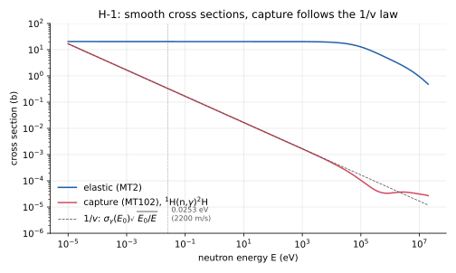
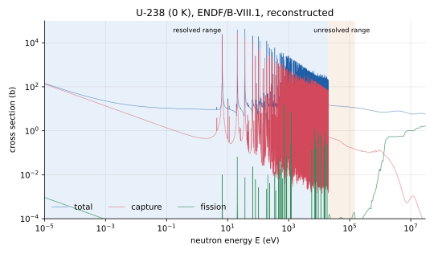

# Neutron cross sections

## What a cross section measures

Send a beam of neutrons, $I$ per cm$^2$ per second, onto a thin target holding
$N$ nuclei per cm$^3$ in a slab of thickness $\mathrm{d}x$. The number of
reactions per cm$^2$ per second is proportional to both:

$$
\mathrm{d}R = \sigma \, I \, N \, \mathrm{d}x .
$$

The constant of proportionality $\sigma$ has the dimension of an area: it is
the **microscopic cross section**, the effective target area one nucleus
presents to a neutron for a given reaction. Nuclear radii are a few
femtometres, so a geometric cross section is of order $10^{-24}$ cm$^2$, and that
became the unit: $1\ \text{barn} = 10^{-24}\,\text{cm}^2$.

Cross sections are *not* geometric areas. Slow neutrons are quantum waves much
larger than the nucleus (chapter 3), and near a resonance a nucleus can look
$10^4$ times larger than its geometric size. Cross sections depend strongly on
the neutron energy $E$, on the nuclide, and on the reaction.

The product $\Sigma = N\sigma$ (cm$^{-1}$) is the **macroscopic cross section**:
the probability of an interaction per cm of travel. An uncollided beam decays
as $I(x) = I_0\, e^{-\Sigma_t x}$, and $1/\Sigma_t$ is the mean free path.
Reaction rates in a reactor are $R = \Sigma\,\phi$, with $\phi$ the scalar flux
(neutrons per cm$^2$ per second, from all directions).

## Partial cross sections

Each possible outcome has its own *partial* cross section, and the **total**
is their sum:

$$
\sigma_t(E) = \sigma_{n,n}(E) + \sigma_{n,n'}(E) + \sigma_{n,\gamma}(E)
+ \sigma_{n,f}(E) + \sigma_{n,2n}(E) + \sigma_{n,\alpha}(E) + \dots
$$

| Reaction | Meaning | Matters for |
| --- | --- | --- |
| elastic $(n,n)$ | neutron bounces off, nucleus left in its ground state | slowing down (moderation) |
| inelastic $(n,n')$ | nucleus left excited; threshold reaction | fast-neutron slowing down |
| capture $(n,\gamma)$ | neutron absorbed, gamma rays emitted | parasitic absorption, breeding |
| fission $(n,f)$ | nucleus splits, releases ~200 MeV and 2–3 neutrons | the chain reaction |
| $(n,\alpha)$, $(n,p)$ | charged particle emitted | absorbers such as B-10 |

The **absorption** cross section collects every reaction that removes the
neutron: $\sigma_a = \sigma_{n,\gamma} + \sigma_{n,f} + \sigma_{n,\alpha} + \dots$

## Energy, speed and the thermal reference point

The neutron's kinetic energy and speed are related by $E = \tfrac12 m_n v^2$.
The reference energy of reactor physics is $E_0 = k_B T = 0.0253$ eV at
$T = 293.6$ K ($8.617\times10^{-5}\ \text{eV/K} \times 293.6\ \text{K}$). A
neutron with this energy moves at

$$
v_0 = \sqrt{\frac{2E_0}{m_n}} = 2200\ \text{m/s},
$$

which is the most probable speed of a Maxwellian gas of neutrons at 293.6 K.

"Thermal cross sections" are values at $E_0$. They are the most precisely
known numbers in the field and a convenient first check for any processing
code.

## The $1/v$ law

Far below its first resonance, the absorption cross section of most nuclides is
inversely proportional to the neutron speed:

$$
\sigma_a(E) = \sigma_a(E_0)\,\sqrt{\frac{E_0}{E}} \quad\Longleftrightarrow\quad v\,\sigma_a = \text{const}.
$$

The reaction *rate per nucleus*, $n v \sigma_a$, is then independent of the
neutron speed: slower neutrons spend proportionally more time near each
nucleus. Chapter 4 derives the law from the resonance formulas. It follows from
two facts: the cross-section scale is $\pi/k^2 \propto 1/E$, and the
probability that a slow s-wave neutron reaches the nucleus grows like
$k \propto \sqrt{E}$.

Hydrogen shows the law in its pure form, since it has no resonances:
$\sigma_{n,\gamma}(E_0) = 0.3326$ b, and the cross section scales as $1/v$
from $10^{-5}$ eV to above 1 MeV. The capture releases 2.225 MeV, the binding
energy of the deuteron that is formed.

## Thermal values used as checks

| Quantity at 0.0253 eV | Computed here | Published [[Mughabghab](#ref-mughabghab)] |
| --- | --- | --- |
| H-1 capture | 0.3326 b | 0.3326 b |
| H-1 elastic (free atom) | 20.44 b | $\approx$ 20.5 b |
| U-238 capture | 2.682 b | 2.680 ± 0.019 b |
| U-235 fission | 586.2 b | 585.1 b |
| U-235 capture | 99.4 b | $\approx$ 99 b |
| U-234 capture | 100.9 b | 100.1 ± 1.3 b |
| natural Zr capture | 0.1885 b | $\approx$ 0.185 b |
| B-10 $(n,\alpha)$ | 3842 b | 3842 ± 8 b |

For uranium every one of these numbers comes from resonance parameters, not
from a tabulated cross section (section 2.7 explains why). Getting them right
is the main test of chapters 4–6.

## The shape of a heavy-nuclide cross section

Going up in energy, the cross section of a heavy nucleus such as U-238 passes
through four regions:

1. **Thermal region** (below ~1 eV): smooth. Capture is $1/v$; elastic
   scattering is nearly constant.
2. **Resolved resonance range** (here 1 eV – 20 keV): sharp peaks, each a
   quantum state of the compound nucleus U-239 (chapter 3). The first U-238
   resonance, at 6.67 eV, reaches 22,800 b in capture at 0 K.
3. **Unresolved resonance range** (20 – 150 keV): resonances still exist but
   are too narrow and too closely spaced to measure one by one. Only average
   parameters are known.
4. **Fast region**: smooth again. Threshold reactions open up (inelastic
   scattering at 45 keV, U-238 fission above ~1 MeV, $(n,2n)$ above 6 MeV).

## Why resonances dominate reactor physics: the resonance integral

In a reactor, neutrons are born at about 2 MeV and slow down by colliding with
the moderator. Under simple assumptions (an infinite medium, weak absorption,
energy-independent scattering) the slowing-down flux per unit energy is

$$
\phi(E) \propto \frac{1}{E},
$$

because each collision removes, on average, a fixed *fraction* of the neutron
energy, so equal intervals of $\ln E$ are crossed at equal rates
[[Bell & Glasstone](#ref-bell) §8.3; [MIT 22.05](#ref-mit2205)]. The capture
rate during slowing down is then proportional to the **resonance integral**

$$
RI = \int_{0.5\ \text{eV}}^{\infty} \sigma_{n,\gamma}(E)\, \frac{\mathrm{d}E}{E}.
$$

The 0.5 eV lower limit is the cadmium cutoff used in experiments: below it, a
cadmium filter absorbs essentially all neutrons.

For U-238 the computed value is **275.3 b** (published: 275 ± 3 b). It is
dominated by a handful of low-energy resonances:

| Contribution to the U-238 capture RI | Barns | Share |
| --- | --- | --- |
| 6.67 eV resonance | 128.9 | 47 % |
| 20.87 eV resonance | 65.8 | 24 % |
| 36.68 eV resonance | 40.9 | 15 % |
| everything from 0.5 eV to 100 eV | 250.2 | 91 % |
| 100 eV – 20 keV | 24.1 | 9 % |
| above 20 keV | 0.9 | 0.3 % |

This is why a lattice code has to represent the first few U-238 resonances
very accurately. In a real fuel pin the flux dips inside each big resonance,
so the effective capture is much smaller than $RI$ suggests
(*self-shielding*, chapters 8, 10 and 11). Calculating that effect is a central job of
lattice physics.

## Further reading

* [[Bell & Glasstone](#ref-bell)] ch. 1 (neutron transport basics) and §8.1,
  §8.3 (resonance cross sections, slowing down and the resonance integral)
  (free, OSTI).
* [[MIT 22.05](#ref-mit2205)]: lecture notes on neutron interactions and
  slowing down (free, MIT OpenCourseWare).
* [[Lamarsh](#ref-lamarsh)], ch. 2–3; [[Duderstadt & Hamilton](#ref-dh)],
  ch. 2 (standard textbooks, not free).
* Code: [`pointwise.py`](../../src/fission/endf/pointwise.py) builds the
  full-range tables used for the figures and the resonance integral
  (`PointwiseTable.integral_over_e`).
