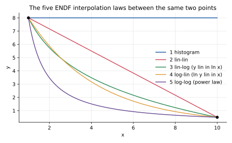

# The ENDF-6 format

## Evaluated data

Nobody measures a cross section at every energy. Evaluators combine
measurements (transmission, capture yields, fission counts) with nuclear models
(R-matrix fits in the resonance range, optical and statistical models at higher
energies) to produce a complete, consistent description of each nuclide. The
result is an **evaluation**, and a set of evaluations released together is a
**library**. The US library is ENDF/B; its current version, ENDF/B-VIII.1, was
released in 2024 [[ENDF/B-VIII.1](#ref-endfb81)]. Other libraries (JEFF, JENDL,
TENDL, CENDL, BROND) use the same file format.

An evaluation does not store "the cross section" as a single table. Where a
compact physical model exists, it stores the *model parameters*: resonance
energies and widths instead of millions of points. Turning those parameters
back into numbers is called **processing**, and it is the subject of these
notes. NJOY is the standard processing code [[NJOY](#ref-njoy)]; here we
rebuild a small part of it to understand it.

The format is defined in the ENDF-6 formats manual [[ENDF-102](#ref-endf102)].
It is long (431 pages) but readable. Sections 0–3 and Appendix D cover
everything used here.

## Lines, fields and numbers

ENDF-6 is a fixed-format text file with 80-character lines ("cards", a relic of
punched cards):

| Columns | Content |
| --- | --- |
| 1–66 | six data fields of 11 characters each |
| 67–70 | MAT: material number (9237 = U-238, 125 = H-1) |
| 71–72 | MF: file number, the *kind* of data |
| 73–75 | MT: section number, the *reaction* |
| 76–80 | line sequence number (optional, absent in ENDF/B-VIII.1) |

A real line, the start of the U-238 capture cross section (MF 3, MT 102):

```text
 9.223800+4 2.360058+2          0          0          0          09237 3102
```

Floating-point numbers are written **without the letter E** to save space:
`9.223800+4` means $9.2238\times10^4$ and `5.298700-1` means $0.52987$. The
first field is $ZA = 1000Z + A = 92238$; the second is AWR, the mass of the
atom in units of the neutron mass.

**AWR is an *atomic* mass ratio:** it includes the electrons. For H-1,
$\text{AWR} = 1.007825\,\text{u} / 1.008665\,\text{u} = 0.999167$, not the
proton/neutron ratio 0.99862 [[ENDF-102](#ref-endf102) §0.5.1.1].

## Record types

Every section is a sequence of a few record types [[ENDF-102](#ref-endf102)
§0.6.4]. Once these can be read, any section of the manual can be decoded.

| Record | Layout | Use |
| --- | --- | --- |
| TEXT | 66 characters | descriptive text |
| CONT | $C_1, C_2, L_1, L_2, N_1, N_2$ (2 floats, 4 integers) | control values |
| HEAD | as CONT, with $C_1 = ZA$, $C_2 = AWR$ | first record of a section |
| LIST | CONT with $N_1 = NPL$, then NPL numbers, 6 per line | parameter lists |
| TAB1 | CONT with $N_1 = NR$, $N_2 = NP$; NR pairs (NBT, INT); NP pairs $(x, y)$ | a function $y(x)$ |
| TAB2 | CONT with NR (NBT, INT) pairs | outer loop of a 2D function |
| SEND, FEND, MEND, TEND | zeros in MT, MF, MAT, or MAT = −1 | end of section, file, material, tape |

The complete U-238 capture section is a HEAD followed by one TAB1 (the notes
to the right of column 80 are annotations, not part of the file):

```text
 9.223800+4 2.360058+2          0          0          0          09237 3102   HEAD: ZA, AWR
 4.806430+6 4.806430+6          0          0          1        1109237 3102   CONT: QM, QI, -, LR, NR=1, NP=110
        110          2                                            9237 3102   NBT=110, INT=2 (lin-lin)
 1.000000-5 0.000000+0 2.000000+4 0.000000+0 2.000000+4 5.298700-19237 3102   (E, sigma) pairs ...
```

Two details are already visible:

* The Q value of capture, 4.806 MeV, is the neutron separation energy of U-239:
  the energy released as gamma rays.
* The cross section is **zero** from $10^{-5}$ eV up to 20 keV, and the energy
  20 keV appears **twice**: once with $\sigma = 0$, once with
  $\sigma = 0.52987$ b. A repeated abscissa is how ENDF writes a
  discontinuity. Below 20 keV the capture cross section must come from
  resonance parameters (section 2.7).

## Files and sections

| MF | Content | Used so far |
| --- | --- | --- |
| 1 | general information; MT451 header and directory, MT452/455/456 $\bar\nu$ | header |
| 2 | resonance parameters (MT151) | yes |
| 3 | cross sections $\sigma(E)$, one section per reaction | yes |
| 4 | angular distributions of emitted neutrons | later (scattering kernels) |
| 5 | energy distributions (e.g. fission spectrum $\chi$) | later |
| 6 | combined energy-angle distributions | later |
| 7 | thermal scattering law $S(\alpha,\beta)$ (separate sublibrary) | later |
| 33 | covariances of cross sections | not planned |

Reaction numbers (MT) [[ENDF-102](#ref-endf102) §0.4.3, Appendix B]:

| MT | Reaction | MT | Reaction |
| --- | --- | --- | --- |
| 1 | total | 18 | fission (total) |
| 2 | elastic | 19, 20, 21, 38 | first-, second-, third-, fourth-chance fission |
| 3 | nonelastic | 51–90 | inelastic to excited level 1–40 |
| 4 | inelastic (sum) | 91 | inelastic to the continuum |
| 5 | anything not given elsewhere | 102 | radiative capture $(n,\gamma)$ |
| 16, 17 | $(n,2n)$, $(n,3n)$ | 103–107 | $(n,p)$, $(n,d)$, $(n,t)$, $(n,{}^3\text{He})$, $(n,\alpha)$ |

## The header, MF1/MT451

The first section identifies the material and sets global flags
[[ENDF-102](#ref-endf102) §1.1]. The ones that matter here:

| Flag | Meaning | U-238 |
| --- | --- | --- |
| ZA, AWR | identity and mass | 92238, 236.006 |
| LRP | resonance parameters: −1 none, 0 radius only, 1 given and *added to* MF3, 2 given for information | 1 |
| LFI | 1 if fissionable | 1 |
| NSUB | sublibrary (10 incident neutrons, 12 thermal scattering) | 10 |
| EMAX | upper energy limit of the evaluation | 30 MeV |
| NWD, NXC | number of text lines; number of sections in the directory | 574, 246 |

The header ends with a **directory**: one line per section, giving its MF, MT
and number of lines. Checking that the directory matches the file is a cheap
integrity test that this project runs on every evaluation it reads.

## Interpolation laws

A TAB1 record gives points $(x_i, y_i)$, and a rule for what happens between
them. The table is split into **regions**: region $r$ ends at point
$\text{NBT}_r$ (1-based) and uses law $\text{INT}_r$
[[ENDF-102](#ref-endf102) §0.5.2]. With $t$ the fractional position between
$(x_1, y_1)$ and $(x_2, y_2)$:

| INT | Name | Formula | Exact for |
| --- | --- | --- | --- |
| 1 | histogram | $y = y_1$ | step functions |
| 2 | lin-lin | $y = y_1 + \dfrac{x - x_1}{x_2 - x_1}(y_2 - y_1)$ | straight lines |
| 3 | lin-log | $y = y_1 + \dfrac{\ln(x/x_1)}{\ln(x_2/x_1)}(y_2 - y_1)$ | $y = a + b\ln x$ |
| 4 | log-lin | $y = y_1 \left(\dfrac{y_2}{y_1}\right)^{(x - x_1)/(x_2 - x_1)}$ | exponentials $y = a e^{bx}$ |
| 5 | log-log | $y = y_1 \left(\dfrac{y_2}{y_1}\right)^{\ln(x/x_1)/\ln(x_2/x_1)}$ | power laws $y = a x^b$ |



Each law is exact for one family of functions, which is why evaluators choose
them. A $1/v$ cross section, $\sigma = C E^{-1/2}$, is a power law: two points
and log-log interpolation reproduce it *exactly* at every energy. That is how
H-1 capture is stored.

**The interpolation law is part of the data.** Interpolating an ENDF table
with a different law gives a different cross section. Section 7.4 shows that
H-1's total and capture tables, stored with different laws, disagree by 0.56%
*between* their tabulated points, even though they agree at the points.

Conventions used by processing codes, and by this project:

* outside its tabulated range a cross section is zero (threshold reactions
  start at their threshold);
* a repeated $x$ marks a discontinuity; exactly at the jump, the value from
  the upper side is used.

## MF3 and the resolved resonance range (LRP = 1)

For nuclides with resonances, the header flag LRP = 1 means: *in the resonance
range, the cross section is the resonance contribution computed from MF2 plus
whatever MF3 contains* [[ENDF-102](#ref-endf102) §2.1, §3]. MF3 then holds only
a smooth **background**, often exactly zero, as in the U-238 capture section
above. Reading MF3 alone gives

$$
\sigma^{\text{MF3}}_{n,\gamma}(\text{U-238}, 0.0253\ \text{eV}) = 0
\qquad\text{instead of}\qquad 2.68\ \text{b}.
$$

Above the resonance ranges, MF3 is complete; at 1 MeV the U-238 total is 7.09 b
straight from MF3.

## Sum rules and redundancy

ENDF stores some sums *and* their parts [[ENDF-102](#ref-endf102) §0.4.3.11]:

$$
\begin{aligned}
\sigma_1 &= \sigma_2 + \sigma_3 &&\text{total = elastic + nonelastic}\\
\sigma_4 &= \textstyle\sum_{MT=51}^{91} \sigma_{MT} &&\text{inelastic = all levels + continuum}\\
\sigma_{18} &= \sigma_{19} + \sigma_{20} + \sigma_{21} + \sigma_{38} &&\text{fission = all chances}\\
\sigma_{103} &= \textstyle\sum_{MT=600}^{649} \sigma_{MT}, \quad \dots &&\text{charged-particle level series}
\end{aligned}
$$

To build a table of independent reactions, keep one member of each family: the
total MT1 plus a **non-redundant set of partials** that should add up to it.
MT5 ("anything not given elsewhere") is a real partial, not a sum. Above
~20 MeV, high-energy evaluations put most of the reaction cross section there,
and leaving it out made the O-16 partials miss the total by 67% at 150 MeV.

At the evaluation's own tabulated energies, MT1 equals the sum of these
partials to the 7 significant digits ENDF can store (relative differences
$\sim 10^{-6}$ for H, O, U-234/235/238, most Zr isotopes). Not every evaluation
is that tidy: B-10 is inconsistent by 0.19% and Zr-92 by 1.4% at some energies.
Processing codes therefore **rebuild the total as the sum of the partials**
rather than trusting MT1 (section 7.4).

## Further reading

* [[ENDF-102](#ref-endf102)] §0.4–0.6: materials, MT numbers, interpolation,
  record types; §1.1: MF1/MT451; §3: MF3 (free).
* [[NJOY](#ref-njoy)] ch. 3.1–3.2: how RECONR reads and unionizes ENDF data
  (free).
* [[ENDF/B-VIII.1](#ref-endfb81)]: what is new in the current library (free,
  arXiv).
* Code: [`records.py`](../../src/fission/endf/records.py) (records),
  [`interpolation.py`](../../src/fission/endf/interpolation.py) (laws),
  [`evaluation.py`](../../src/fission/endf/evaluation.py) (header, MF3),
  [`reactions.py`](../../src/fission/endf/reactions.py) (MT names),
  [`pointwise.py`](../../src/fission/endf/pointwise.py) (`partial_mts`),
  [`data.py`](../../src/fission/data.py) (downloading the library).
