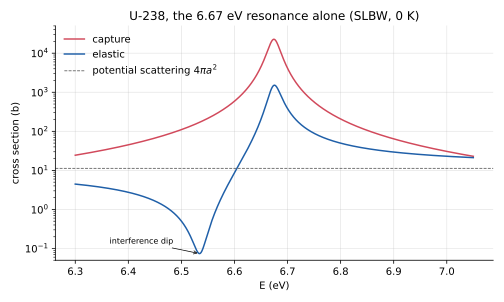

# Single-Level Breit–Wigner (SLBW)

The Breit–Wigner formula (1936) describes a single, isolated resonance
[[Breit & Wigner](#ref-breitwigner)]. It is the simplest resonance formalism,
the building block of MLBW (chapter 5), and the limit that Reich–Moore must
reproduce for one level (chapter 6). None of our nuclides is evaluated with
SLBW, but every one of its ingredients reappears later.

## The formulas

For each resonance $r$, with spin $J$ and orbital momentum $l$
[[ENDF-102](#ref-endf102) §D.1.1, eqs. D.2–D.9]:

$$
\sigma_{n,\gamma}(E) = \frac{\pi}{k^2}\sum_r g_J\,
\frac{\Gamma_{nr}\,\Gamma_{\gamma r}}{(E - E_r')^2 + \tfrac14\Gamma_r^2},
\qquad
\sigma_{n,f}(E) = \frac{\pi}{k^2}\sum_r g_J\,
\frac{\Gamma_{nr}\,\Gamma_{fr}}{(E - E_r')^2 + \tfrac14\Gamma_r^2},
$$

$$
\sigma_{n,n}(E) = \sum_l \frac{4\pi}{k^2}(2l+1)\sin^2\varphi_l
\;+\; \frac{\pi}{k^2}\sum_r g_J\,
\frac{\Gamma_{nr}^2 - 2\Gamma_{nr}\Gamma_r\sin^2\varphi_l
+ 2(E - E_r')\,\Gamma_{nr}\sin 2\varphi_l}
{(E - E_r')^2 + \tfrac14\Gamma_r^2}.
$$

The ingredients, all from chapter 3:

* $k(E)$, the wave number; $\pi/k^2$ sets the scale.
* $g_J$, the spin factor.
* $\Gamma_{nr} = \Gamma_{nr}(E) = \Gamma_n(|E_r|)\,P_l(E)/P_l(|E_r|)$, the
  energy-dependent neutron width.
* $\Gamma_r = \Gamma_{nr}(E) + \Gamma_{\gamma r} + \Gamma_{fr}$, the total width.
* $\varphi_l$, the hard-sphere phase shift.
* $E_r'$, the resonance energy shifted by the shift factor:

$$
E_r' = E_r + \frac{S_l(|E_r|) - S_l(E)}{2P_l(|E_r|)}\,\Gamma_n(|E_r|) .
$$

For s-waves $S_0 = 0$, so $E_r' = E_r$.

Read the capture formula as Bohr's two-step picture:

$$
\sigma_{n,\gamma} = \underbrace{\frac{\pi}{k^2} g_J
\frac{\Gamma_n\Gamma}{(E-E_r)^2 + \Gamma^2/4}}_{\text{formation of the compound nucleus}}
\;\times\; \underbrace{\frac{\Gamma_\gamma}{\Gamma}}_{\text{branching to }\gamma} .
$$

The energy dependence is a **Lorentzian** of full width at half maximum
$\Gamma$: the line shape of any damped oscillator driven near resonance.

## Derivation from the collision function (derivation)

Scattering theory describes each spin channel by a complex number, the
**collision function** $U$ (the S-matrix element). An outgoing wave is the
incoming wave multiplied by $U$. Two results hold in general for a channel with
spin weight $g$ [[Lane & Thomas](#ref-lanethomas); [Fröhner](#ref-frohner)
§3.2]:

$$
\sigma_{\text{elastic}} = \frac{\pi}{k^2}\, g\, |1 - U|^2,
\qquad
\sigma_{\text{reaction}} = \frac{\pi}{k^2}\, g\, \left(1 - |U|^2\right).
$$

The first measures how much the wave changed; the second measures how much
flux went missing (absorbed or sent into other channels). Since $|U| \le 1$
when flux is conserved, both are non-negative.

A hard sphere alone gives a pure phase, $U = e^{-2i\varphi}$, so
$\sigma_{\text{elastic}} = (\pi/k^2) g\, |1 - e^{-2i\varphi}|^2 = (4\pi/k^2)\, g
\sin^2\varphi$: potential scattering. A single resonance adds a pole:

$$
U = e^{-2i\varphi}\left[1 + \frac{i\,\Gamma_n}{E_r' - E - i\Gamma/2}\right].
$$

**Reaction cross section.** With $x = E_r' - E$ and $D = x - i\Gamma/2$,

$$
|U|^2 = \left|\frac{D + i\Gamma_n}{D}\right|^2
= \frac{x^2 + (\Gamma_n - \Gamma/2)^2}{x^2 + \Gamma^2/4},
\qquad
1 - |U|^2 = \frac{\Gamma_n(\Gamma - \Gamma_n)}{x^2 + \Gamma^2/4}.
$$

The absorbed flux is shared among the non-neutron channels in proportion to
their widths. The capture fraction is $\Gamma_\gamma/(\Gamma - \Gamma_n)$,
which gives exactly the capture formula above.

**Elastic cross section.** Multiplying $1 - U$ by the unit-modulus factor
$e^{i\varphi}$ does not change its modulus:

$$
|1 - U|^2 = \left|2\sin\varphi - e^{-i\varphi}\frac{\Gamma_n}{D}\right|^2
= 4\sin^2\varphi
+ \frac{\Gamma_n^2 - 2\Gamma_n\Gamma\sin^2\varphi - 2x\,\Gamma_n\sin 2\varphi}{x^2 + \Gamma^2/4}.
$$

Multiplying by $(\pi/k^2) g$ and using $x = E_r' - E$ reproduces the elastic
formula term by term: **potential scattering**, the **resonance** peak
$\propto \Gamma_n^2$, and the **interference** term
$\propto (E - E_r')\sin 2\varphi_l$.

## The 6.67 eV resonance of U-238

Parameters: $E_r = 6.674$ eV, $J = \tfrac12$ ($g = 1$),
$\Gamma_n = 1.492$ meV, $\Gamma_\gamma = 22.71$ meV, so $\Gamma = 24.20$ meV.
At the resonance, $k = 5.651\times10^{-3}$ and $\pi/k^2 = 98\,363$ b.

**Peak capture.** At $E = E_r$:

$$
\sigma_{n,\gamma}(E_r) = \frac{4\pi}{k^2}\,g\,\frac{\Gamma_n\Gamma_\gamma}{\Gamma^2}
= 393\,452\ \text{b} \times \frac{1.492 \times 22.71}{24.20^2} = 22\,765\ \text{b}.
$$

Only $\Gamma_n/\Gamma = 6\%$ of the formation strength is "used", because the
neutron width is small. A neutron captured into this state decays by gamma
emission 94% of the time.

**Area.** Integrating the Lorentzian, $\int \mathrm{d}E/(x^2 + \Gamma^2/4) =
2\pi/\Gamma$, gives

$$
\int \sigma_{n,\gamma}\,\mathrm{d}E = \frac{2\pi^2}{k^2}\, g\,\frac{\Gamma_n\Gamma_\gamma}{\Gamma}
\approx 865\ \text{b eV},
$$

independent of the line *shape*. This is what an experiment measuring
integrated capture determines, and it is preserved by Doppler broadening
(chapter 8). Divided by $E_r$, it estimates this resonance's contribution to
the resonance integral: $865/6.674 = 130$ b, against 128.9 b from the full
reconstruction (section 1.7).

**The interference dip.** For $|E - E_r| \gg \Gamma$ and a small phase
($\varphi \approx k\,AP = 0.0054$), the real part of
$2\sin\varphi - e^{-i\varphi}\Gamma_n/D$ vanishes when
$2\varphi \approx \Gamma_n/(E_r - E)$, that is at

$$
E_{\text{dip}} \approx E_r - \frac{\Gamma_n}{2\varphi} = 6.674 - \frac{0.001492}{0.0107} = 6.535\ \text{eV}.
$$

There the resonance amplitude cancels the potential-scattering amplitude, and
elastic scattering drops from 11.3 b to 0.07 b. The dip is real and is seen in
transmission measurements. Above the resonance the two amplitudes add, so the
elastic wing on the high side is higher than on the low side.

**The $1/v$ tail.** Far below the resonance ($E \ll E_r$), the denominator is
$\approx E_r^2$, $\Gamma_n(E) \propto P_0 \propto \sqrt{E}$, and
$\pi/k^2 \propto 1/E$:

$$
\sigma_{n,\gamma}(E) \propto \frac{1}{E}\cdot\sqrt{E} = \frac{1}{\sqrt{E}} \propto \frac{1}{v}.
$$

At 0.0253 eV the 6.67 eV resonance alone gives 1.22 b of capture. Summed over
all 3345 U-238 levels (22 of them bound levels), SLBW gives 2.682 b,
very close to the measured 2.680 b. The thermal capture cross section is the
sum of many resonance tails.

## What SLBW gets wrong

SLBW treats every resonance as if the others did not exist. The total
amplitude of a channel is really a *sum* of the potential amplitude and all
resonance amplitudes, and the cross section is its squared modulus:

$$
|a_{\text{pot}} + a_1 + a_2 + \dots|^2
= |a_{\text{pot}}|^2 + \sum_r |a_r|^2 + \sum_r 2\,\mathrm{Re}(a_{\text{pot}}a_r^*)
+ \underbrace{\sum_{r < r'} 2\,\mathrm{Re}(a_r a_{r'}^*)}_{\text{missing in SLBW}} .
$$

SLBW keeps everything except the resonance–resonance cross terms. Those can be
large and of either sign. Without them nothing guarantees a positive result:
just below 6.67 eV, where several levels' interference terms add up, the SLBW
elastic cross section of U-238 comes out at **−1.86 b**. The collision
matrix is no longer unitary; flux is not conserved.

For capture in widely spaced, narrow resonances (U-238 at low energy) the
damage is small, since thermal and resonance capture come out right. For
overlapping resonances it is not: SLBW underestimates U-235 thermal fission by
11% (chapter 6). The multi-level formalisms fix this.

A last detail, found while testing: the evaluation gives U-238's low
resonances a fission width of about $10^{-8}$ eV (**subthreshold fission**).
It is real, but six orders of magnitude below capture.

## Further reading

* [[ENDF-102](#ref-endf102)] §D.1.1 (free).
* [[Fröhner](#ref-frohner)] §3.3.2, SLBW and its relation to the exact
  R-matrix expressions (free).
* [[Bell & Glasstone](#ref-bell)] §8.1b (the SLBW formula) and §8.1e
  (overlap and interference of resonances) (free).
* [[Breit & Wigner](#ref-breitwigner)], the original paper (not free).
* Code: [`slbw.py`](../../src/fission/endf/slbw.py) (`single_resonance`
  returns every ingredient above; `slbw` sums the levels). Try
  `make scan NUC=U238 E=20.87`.
