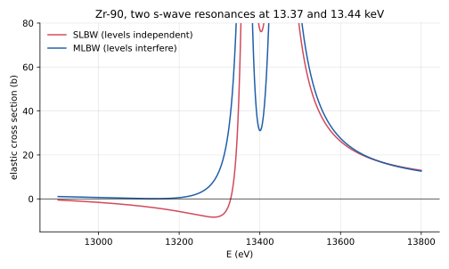

# Multi-Level Breit–Wigner (MLBW)

MLBW repairs the most visible defect of SLBW, the missing interference between
resonances, but only for elastic scattering. In ENDF/B-VIII.1 it is used by
U-234 and by all five zirconium isotopes of the cladding.

## The formulas

For every spin group, meaning all resonances sharing $l$, channel spin $s$ and
$J$, the elastic collision function collects all levels
[[ENDF-102](#ref-endf102) eqs. D.19–D.21]:

$$
U_{nn}^{lsJ}(E) = e^{-2i\varphi_l}\left[1 + \sum_{r \in lsJ}
\frac{i\,\Gamma_{nr}}{E_r' - E - i\Gamma_r/2}\right],
$$

$$
\sigma_{n,n}(E) = \frac{\pi}{k^2}\sum_{l}\sum_{s}\sum_{J} g_J\,
\left|1 - U_{nn}^{lsJ}(E)\right|^2 .
$$

The widths, shifted energies and phase shifts are those of SLBW
(chapter 4). Capture and fission keep the **single-level** expressions
[[ENDF-102](#ref-endf102) §D.1.2]:

> "the ENDF version of the multilevel Breit–Wigner formalism does not
> correspond exactly to the full multilevel formalism because it allows
> multilevel computations only for elastic; for other types of partial cross
> sections the formalism is single-level."

So MLBW is SLBW plus resonance–resonance interference in elastic scattering.

## What changed, and what did not

* **One level:** the sum has a single term and $U$ is exactly the
  single-level collision function of section 4.2. MLBW and SLBW then agree
  identically, which the tests check to $10^{-9}$.
* **Elastic is positive by construction:** $|1 - U|^2 \ge 0$, whatever the
  parameters.
* **The interference term.** Expanding the squared modulus shows what SLBW
  dropped. For two levels $r \ne r'$ of the same spin group the extra elastic
  cross section is [[ENDF-102](#ref-endf102) eq. D.15]

$$
\sigma^{(R)}_{n,n} = \frac{\pi}{k^2} g_J\,
\frac{2\Gamma_{nr}\Gamma_{nr'}\left[(E - E_r')(E - E_{r'}') + \tfrac14\Gamma_r\Gamma_{r'}\right]}
{\left[(E - E_r')^2 + \tfrac14\Gamma_r^2\right]\left[(E - E_{r'}')^2 + \tfrac14\Gamma_{r'}^2\right]} .
$$

  Between two resonances $(E - E_r')$ and $(E - E_{r'}')$ have opposite signs,
  so the term is negative there and positive outside. The two levels'
  amplitudes cancel between them and reinforce outside.
* **Not unitary.** Nothing forces $|U| \le 1$, so
  $1 - |U|^2$ could be negative. MLBW never uses $1 - |U|^2$, however: its
  capture and fission are single-level. The defect is hidden rather than
  repaired. Reich–Moore repairs it.

## An example: two close resonances in Zr-90

Zr-90 has two s-wave resonances only 79 eV apart, at 13,365 eV
($\Gamma_n = 30$ eV) and 13,444 eV ($\Gamma_n = 53$ eV). These are broad
compared with their spacing, so their amplitudes overlap strongly.

At 13.28 keV, just below the pair, SLBW gives **−8.3 b** and MLBW
**+7.3 b**. Between the peaks, MLBW is much lower than SLBW (31 b against
76 b at the minimum), the cancellation predicted by the interference term.

## Channel spin, and the "missing" spin weight

The ENDF formula sums over the channel spin $s$ as well as $J$. When the target
has spin ($I > 0$) and $l > 0$, the same $J$ can be reached from both
$s = I - \tfrac12$ and $s = I + \tfrac12$. The LRF = 2 format, however, gives
each resonance only $J$, not $s$.

Take Zr-91 ($I = \tfrac52$, so $s = 2$ or $3$) with p-waves ($l = 1$):

| $s$ | allowed $J$ | $\sum g_J$ |
| --- | --- | --- |
| 2 | 1, 2, 3 | $(3+5+7)/12 = 15/12$ |
| 3 | 2, 3, 4 | $(5+7+9)/12 = 21/12$ |
| both | — | $36/12 = 3 = 2l+1$ |

The four *distinct* $J$ values carry only $(3+5+7+9)/12 = 2$ of the 3 units of
spin weight; $J = 2$ and $J = 3$ each occur twice. This project builds one
collision function per $(l, |J|)$ from the resonances given. Every unit of
spin weight not covered by such a group, here at least 1, contributes
hard-sphere scattering only:

$$
\sigma_{\text{pot}}^{\text{missing}} = \frac{4\pi}{k^2}\Big[(2l+1) - \sum_{J\ \text{resonant}} g_J\Big]\sin^2\varphi_l .
$$

This is the treatment the ENDF manual recommends for formats without channel
spin: assign the resonances to one channel spin and put potential scattering
in the missing channels [[ENDF-102](#ref-endf102) §D.1.3, §2.4.20]. Of our
nuclides it only affects the p-waves of Zr-91, where it changes the elastic
cross section by a small amount.

## Checks

| Quantity at 0.0253 eV | Computed (MLBW + MF3 background) | Published [[Mughabghab](#ref-mughabghab)] |
| --- | --- | --- |
| U-234 capture | 100.9 b | 100.1 ± 1.3 b |
| natural Zr capture | 0.1885 b | ≈ 0.185 b |

The natural-zirconium value is the abundance-weighted sum over Zr-90 (51.45%),
Zr-91 (11.22%), Zr-92 (17.15%), Zr-94 (17.38%) and Zr-96 (2.80%). Zr-91
supplies 72% of the capture with 11% of the atoms ($\sigma_\gamma = 1.21$ b).
This is why cladding is modelled isotope by isotope.

## Status of MLBW

The ENDF manual discourages MLBW for new work: "The use of this formalism is
NOT recommended. Computation time is no longer a valid issue for modern
computers. All new evaluations should be done with the Reich-Moore formalism"
[[ENDF-102](#ref-endf102) §D.1.2]. MLBW survives in older evaluations, such as
those of zirconium, where resonances are mostly narrow and fission is absent.

## Further reading

* [[ENDF-102](#ref-endf102)] §D.1.2 and §2.4.12 (the equivalent
  "Adler–Gauss" form with only $N$ terms instead of $N^2$) (free).
* [[Fröhner](#ref-frohner)] §3.3.3 (free).
* Code: [`mlbw.py`](../../src/nodal/endf/mlbw.py) (reference) and its Rust
  port [`mlbw.rs`](../../rust/src/mlbw.rs). The potential-scattering
  bookkeeping is `potential_terms` in
  [`reich_moore.py`](../../src/nodal/endf/reich_moore.py), shared by both
  formalisms.
