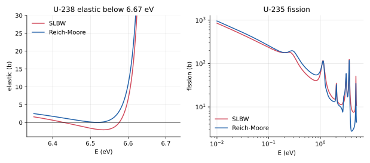

# R-matrix theory and the Reich–Moore formalism

Reich–Moore is the formalism of the two nuclides that matter most in a PWR,
U-235 and U-238. It treats interference between resonances properly in every
reaction, conserves flux by construction, and is nearly exact for neutron
resonances. It is an approximation to **R-matrix theory**, which this chapter
sketches first.

## R-matrix theory in one page (derivation)

Wigner and Eisenbud's idea [[Wigner & Eisenbud](#ref-wignereisenbud);
[Lane & Thomas](#ref-lanethomas)] is to cut space at the channel radius $a$:

* **Inside** ($r < a$) the many-body nuclear problem is unknown, but whatever
  it is, its solutions can be expanded in a complete set of states $\lambda$
  with energies $E_\lambda$. A state couples to channel $c$ with a real
  **reduced-width amplitude** $\gamma_{\lambda c}$.
* **Outside** ($r > a$) the particles move freely, described by the
  hard-sphere functions of chapter 3.

Matching the inside and outside solutions at $r = a$ involves only the
**R-matrix**,

$$
R_{cc'}(E) = \sum_\lambda \frac{\gamma_{\lambda c}\,\gamma_{\lambda c'}}{E_\lambda - E},
$$

a real, symmetric matrix over channels whose poles are the levels. The collision
matrix follows as [[ENDF-102](#ref-endf102) eqs. D.40–D.43]

$$
U = \Omega\, P^{1/2}\,(I - RL)^{-1}(I - RL^*)\,P^{-1/2}\,\Omega,
\qquad L = S - B + iP,
\qquad \Omega_c = e^{-i\varphi_c},
$$

with $P$, $S$ and $\varphi$ the penetrabilities, shift factors and phase shifts
(diagonal matrices) and $B$ a boundary constant chosen by the evaluator.
Neither $a$ nor $B$ is physical: changing them changes the level parameters
$E_\lambda$ and $\gamma_{\lambda c}$, but not $U$ or any cross section
[[Lane & Thomas](#ref-lanethomas) §IV.2]. Two properties make this the
foundation of resonance analysis:

* **It is exact**, given enough levels and channels, and $U$ is unitary and
  symmetric.
* **Every level couples to every channel.** Levels sharing a channel interfere
  automatically, in every reaction.

The difficulty is size. A heavy nucleus has thousands of open **photon
channels** (gamma transitions to all lower states), so $R$ would be a huge
matrix.

## The Reich–Moore approximation

Reich and Moore [[Reich & Moore](#ref-reichmoore)] noticed that the photon
channels behave statistically. Their amplitudes $\gamma_{\lambda c}$ for
different levels have random signs, so in sums over photon channels the
off-diagonal combinations $\sum_{c\in\gamma}\gamma_{\lambda c}\gamma_{\mu c}$
($\lambda \ne \mu$) average to nearly zero. Only the diagonal terms survive, and
they add up to the radiation width $\Gamma_{\lambda\gamma}$. Eliminating the
photon channels then leaves an R-matrix over the few remaining channels, with
each level energy shifted into the complex plane:

$$
E_\lambda \;\longrightarrow\; E_\lambda - \frac{i}{2}\,\Gamma_{\lambda\gamma} .
$$

The gamma width is not dropped; it becomes the "damping" of each level. The
approximation fails only if a few gamma transitions dominate, which does not
happen for heavy nuclei.

**Channel elimination (derivation).** The rigorous version of this step is
the channel-elimination method of Teichmann and Wigner
[[Lane & Thomas](#ref-lanethomas) §X]. Split the channels into those we keep
($r$: neutron, fission) and those we eliminate ($e$: photons). In the
eliminated channels only outgoing waves exist, so their logarithmic
derivatives are known, $L_e^0 = L_e - B_e$, and the matching conditions can
be solved for them. What remains is a **reduced R matrix** over the kept
channels alone,

$$
\mathfrak{R}_{rr} = R_{rr} + R_{re}\,L_e^0\,(1 - R_{ee}L_e^0)^{-1}\,R_{er},
$$

which reproduces the kept part of the collision matrix exactly. Two facts
follow:

* If any eliminated channel is open, $L_e^0$ is complex and so is
  $\mathfrak{R}$. The collision matrix of the kept channels is then **not
  unitary** (Lane & Thomas eq. X.1.5a): flux disappears into the eliminated
  channels. In Reich–Moore that missing flux is the capture cross section:
  the manual obtains it by subtraction (section 6.4), this project directly
  from the flux each level loses (section 6.5).
* Written as a level matrix, $\mathfrak{R}$ involves the matrix
  $\xi_{\lambda\mu} = \sum_{e}\gamma_{\lambda e}L_e^0\gamma_{\mu e}$
  over the eliminated channels only. With many photon channels whose
  amplitudes have random signs (Bethe's assumption), the off-diagonal
  elements have a most probable value of zero, while the diagonal elements
  add up to $-\tfrac{i}{2}\Gamma_{\lambda\gamma}$ (Lane & Thomas §XI.2).
  Dropping the off-diagonal part is exactly the Reich–Moore approximation. That is why the ENDF manual calls Reich–Moore the
recommended formalism.

## The ENDF form (LRF = 3)

In ENDF's Reich–Moore format each spin group has at most three channels: one
neutron channel $n$ and two **fission channels** $f_1$, $f_2$. The fission
channels are not actual fragment pairs but "Bohr channels" in deformation
space; two are enough to describe the fission cross sections of the actinides
[[ENDF-102](#ref-endf102) §D.1.3]. Define for each resonance $r$ the vector of
signed amplitudes

$$
\mathbf a_r = \left(\sqrt{\Gamma_{nr}(E)},\;
\pm\sqrt{|\Gamma_{f_1 r}|},\; \pm\sqrt{|\Gamma_{f_2 r}|}\right),
$$

where the fission signs are the signs given in the file (fields GFA, GFB). They
decide whether neighbouring levels interfere constructively or destructively
in fission. With the complex level denominator

$$
D_r = E_r - E - \tfrac{i}{2}\Gamma_{\gamma r},
$$

the channel matrix is [[ENDF-102](#ref-endf102) eq. D.28]

$$
K = \frac{i}{2}\sum_r \frac{\mathbf a_r\,\mathbf a_r^{\mathsf T}}{D_r},
\qquad (I - K)_{cc'} = \delta_{cc'} - \frac{i}{2}\sum_r
\frac{\sqrt{\Gamma_{rc}}\sqrt{\Gamma_{rc'}}}{E_r - E - i\Gamma_{\gamma r}/2},
$$

and the collision-matrix elements are [[ENDF-102](#ref-endf102) eq. D.27]

$$
U_{nn} = e^{-2i\varphi_l}\left[2\,(I - K)^{-1}_{nn} - 1\right],
\qquad
U_{nf} = 2\, e^{-i\varphi_l}\,(I - K)^{-1}_{nf} .
$$

ENDF's Reich–Moore sets the shift factor to zero ($E_r' = E_r$). That is exact
for s-waves, and for higher $l$ the manual judges the difference "of no
practical significance".

All three rows of $(I - K)^{-1}$ that we need are obtained by solving one small
linear system per spin group and energy:

$$
(I - K)\,\mathbf x = \mathbf e_n, \qquad
\mathbf x = (x_n, x_{f_1}, x_{f_2}) .
$$

## Cross sections

With $g_J$ the spin factor of the group and $\sum_{lJ}$ a sum over spin
groups, plus hard-sphere terms for the missing spin weight (section 5.4):

$$
\begin{aligned}
\sigma_t &= \frac{2\pi}{k^2}\sum_{lJ} g_J\,\left(1 - \mathrm{Re}\,U_{nn}\right)
&&\text{total (optical theorem)}\\
\sigma_{n,n} &= \frac{\pi}{k^2}\sum_{lJ} g_J\,\left|1 - U_{nn}\right|^2
&&\text{elastic}\\
\sigma_{n,f} &= \frac{4\pi}{k^2}\sum_{lJ} g_J\,\left(|x_{f_1}|^2 + |x_{f_2}|^2\right)
&&\text{fission}\\
\sigma_{n,\gamma} &= \frac{\pi}{k^2}\sum_{lJ} g_J \sum_r \Gamma_{\gamma r}\,|A_r|^2,
\quad A_r = \frac{\mathbf a_r^{\mathsf T}\mathbf x}{D_r}
&&\text{capture}
\end{aligned}
$$

The first three are the manual's eqs. D.23, D.24 and D.33. The manual obtains
capture by subtraction, $\sigma_{n,\gamma} = \sigma_t - \sigma_{n,n} -
\sigma_{n,f}$, and warns that the formulas "can lead to serious numerical
problems if programmed in this form" [[ENDF-102](#ref-endf102) §D.1.3]. This
project uses the direct form in the last line instead. $A_r$ is the amplitude
with which level $r$ is excited, and $\Gamma_{\gamma r}|A_r|^2$ is the flux it
loses to gamma emission. The next section derives it.

## Capture without subtraction (derivation)

From $(I - K)\mathbf x = \mathbf e_n$ and the form of $K$:

$$
\mathbf x = \mathbf e_n + K\mathbf x
= \mathbf e_n + \frac{i}{2}\sum_r \mathbf a_r \frac{\mathbf a_r^{\mathsf T}\mathbf x}{D_r}
= \mathbf e_n + \frac{i}{2}\sum_r \mathbf a_r A_r .
$$

Multiply on the left by $\mathbf x^\dagger$. The amplitudes $\mathbf a_r$ are
real, so $\mathbf x^\dagger\mathbf a_r = (\mathbf a_r^{\mathsf T}\mathbf x)^* =
(D_r A_r)^*$:

$$
\mathbf x^\dagger\mathbf x = x_n^* + \frac{i}{2}\sum_r D_r^*\,|A_r|^2 .
$$

The left side is real, so it equals the real part of the right side. Since
$\tfrac{i}{2}D_r^* = \tfrac{i}{2}(E_r - E) - \tfrac14\Gamma_{\gamma r}$, whose
real part is $-\Gamma_{\gamma r}/4$:

$$
\boxed{\;\mathrm{Re}\,x_n - \sum_c |x_c|^2 = \frac14\sum_r \Gamma_{\gamma r}\,|A_r|^2\;}
$$

This one identity gives two results.

**Unitarity.** The right side is $\ge 0$ because $\Gamma_\gamma \ge 0$. Since
$|U_{nn}|^2 = |2x_n - 1|^2 = 1 - 4(\mathrm{Re}\,x_n - |x_n|^2)$ and
$|U_{nf}|^2 = 4|x_f|^2$,

$$
1 - |U_{nn}|^2 - \sum_f |U_{nf}|^2 = 4\Big(\mathrm{Re}\,x_n - \sum_c |x_c|^2\Big) \ge 0 .
$$

No more flux leaves through the neutron and fission channels than came in.
In particular $|U_{nn}| \le 1$, so elastic scattering can never be negative.
The missing flux is exactly what the eliminated photon channels absorb.

**Capture.** Capture is the absorbed flux minus fission,
$\sigma_{n,\gamma} = (\pi/k^2)\,g_J\,(1 - |U_{nn}|^2 - \sum_f |U_{nf}|^2)$, and
by the identity

$$
\sigma_{n,\gamma} = \frac{4\pi}{k^2}\, g_J\Big(\mathrm{Re}\,x_n - \sum_c|x_c|^2\Big)
= \frac{\pi}{k^2}\, g_J \sum_r \Gamma_{\gamma r}\,|A_r|^2 .
$$

Every term on the right is positive, so nothing cancels.

**Why it matters numerically.** Far from resonances, capture is $10^{-6}$ of
elastic. Computed as $\sigma_t - \sigma_{n,n} - \sigma_{n,f}$, it is the small
difference of two numbers near 11 b, and its last digits are rounding noise.
In this project the subtraction form disagreed with the single-level limit at
the $10^{-7}$ level, which the tests caught. The direct form agrees to
$10^{-9}$. The optical-theorem total, computed independently, still equals
elastic + capture + fission to $10^{-8}$, a check on everything at once.

## One level: back to Breit–Wigner

For a single level without fission, $K$ is $1\times1$:

$$
x_n = \frac{1}{1 - \dfrac{i\Gamma_n/2}{E_r - E - i\Gamma_\gamma/2}}
= \frac{E_r - E - i\Gamma_\gamma/2}{E_r - E - i\Gamma/2},
\qquad
U_{nn} = e^{-2i\varphi}\left[1 + \frac{i\Gamma_n}{E_r - E - i\Gamma/2}\right],
$$

exactly the single-level collision function of section 4.2. With fission, $K$
is a rank-one matrix $\tfrac{i}{2}\mathbf a\mathbf a^{\mathsf T}/D$, and the
same steps give the SLBW fission formula with $\Gamma_f = |\Gamma_{f_1}| +
|\Gamma_{f_2}|$. Reich–Moore therefore *contains* SLBW. The two differ only
through interference between levels, and (for $l > 0$) the shift factor that
Reich–Moore omits.

## What interference does

| Quantity at 0.0253 eV | Reich–Moore | SLBW (same parameters) | Published |
| --- | --- | --- | --- |
| U-238 capture | 2.682 b | 2.682 b | 2.680 ± 0.019 b |
| U-235 fission | **586.2 b** | 519.6 b (−11%) | 585.1 b |
| U-235 capture | **99.4 b** | 88.5 b (−11%) | ≈ 99 b |

* **U-238** resonances are narrow ($\Gamma \approx 25$ meV) and widely spaced
  (18.5 eV on average for s-waves below 100 eV), so they barely overlap. Capture is nearly
  single-level; interference shows only in elastic scattering, where it removes
  SLBW's negative values.
* **U-235** resonances are broad, because fission widths (median 0.12 eV)
  add to $\Gamma_\gamma \approx 0.04$ eV, and closely spaced (0.48 eV on
  average below 100 eV, both spin states together). Neighbouring
  levels overlap, and the signed fission amplitudes make them interfere
  constructively in some places and destructively in others. Even the thermal
  cross section, the sum of many level tails, is off by 11% without
  interference. Every reactor calculation depends on this number, so for
  fissile nuclides a multi-level formalism is not optional.

Interference also shapes the valleys between levels. Lane and Thomas show
that with only two open channels a reaction cross section can vanish exactly
between two levels, when the products of their amplitudes have the same sign;
with more channels it never vanishes [[Lane & Thomas](#ref-lanethomas)
§XII.5]. U-235 has several (neutron, two fission channels, and capture
through the damping), and its fission cross section shows exactly that
behaviour: between 1 and 100 eV it has 139 local minima, the deepest
0.023 b against a maximum of 1225 b, deep but never zero.

## Potential scattering and the "missing" channels

As in MLBW, spin weight not covered by resonant spin groups contributes
hard-sphere scattering (section 5.4). Reich–Moore evaluations add the field
NLSC, the number of $l$ values needed for potential scattering to converge.
U-235 lists resonances for $l = 0$ only, but NLSC = 4, so hard-sphere scattering
from $l = 0$ through $3$ must be included. For $l = 1, 2, 3$ none of the spin
weight is resonant, so each contributes $(4\pi/k^2)(2l+1)\sin^2\varphi_l$. At low
energy these terms are tiny ($\sin^2\varphi_l \propto \hat\rho^{4l+2}$), but they
grow in the keV range.

## The general format: R-Matrix Limited (LRF = 7)

LRF = 3 hides much of R-matrix theory behind conventions. There is one neutron
channel per $(l, J)$. Two channel spins of a target with spin are merged. Two
fission channels are allowed, and potential scattering comes from NLSC. Modern
evaluations, done with codes such as SAMMY, are written in the **R-Matrix
Limited** format instead [[ENDF-102](#ref-endf102) §2.2.1.6], which states
everything explicitly. ENDF/B-VIII.1 uses it for silicon (Si-28, 29, 30) and
for Fe-54 and Fe-57: the nuclides of the steel and the Pyrex glass of
chapter 22.

The file first lists **particle pairs**: the two particles a channel holds,
with their masses, spins, charges, Q-value and the MT the pair stands for.
For neutrons there are always at least two pairs: γ + compound nucleus
(MT = 102) and n + target in its ground state (MT = 2). Fe-57 adds a third,
n + Fe-57 in its first excited state (MT = 51, Q = −14.4 keV), an inelastic
channel. Then come the **spin groups**, one per total spin and parity
$J^\pi$, the only quantities R-matrix theory conserves. Each spin group
lists its channels (pair, $l$, channel spin $s$, and two radii: APE for the
phase shift, APT for the penetrability) and its levels, each with one width
per channel. Si-28 (target spin 0) has seven spin groups, $J^\pi$ from
$\tfrac12^+$ ($l = 0$) to $\tfrac72^-$ ($l = 3$). Si-29 has spin $\tfrac12$,
so a neutron can arrive with channel spin $s = 0$ or $1$, and the file keeps
them apart: two separate $1^-$ groups, one for each $s$. LRF = 3 has no
place for that distinction; it is the convention with negative $J$ that
still stops Cr-53 and Mn-55 here.

The flag KRM says which approximation of R-matrix theory the parameters
belong to. All five files use KRM = 3, Reich–Moore: the γ pair is the
eliminated channel, and its widths only appear as $-i\Gamma_{\lambda\gamma}/2$
in the level denominators. ENDF-102 (D.44–D.54) writes the cross sections
through $X = P^{1/2}L^{-1}(L^{-1}-R)^{-1}RP^{1/2}$, with the shift factors in
$L = S - B + iP$. None of our files asks for shift factors (SHF = 0), so
$L = iP$. With widths given at the level energies (IFG = 0), the energy-dependent
amplitude of level $\lambda$ in channel $c$ is

$$
a_{\lambda c}(E) = \operatorname{sign}(\Gamma_{\lambda c})\sqrt{|\Gamma_{\lambda c}|\,P_c(E)/P_c(|E_\lambda|)}
$$

and everything reduces to the matrix $K$ of this chapter, now with one row per
neutron channel of the group:

$$
K_{cc'} = \frac{i}{2}\sum_\lambda \frac{a_{\lambda c}\,a_{\lambda c'}}{E_\lambda - E - i\Gamma_{\lambda\gamma}/2},
\qquad
U_{cc'} = e^{-i\varphi_c}\big(2[(1-K)^{-1}]_{cc'} - \delta_{cc'}\big)e^{-i\varphi_{c'}} .
$$

For every incident neutron channel $c$ the elastic cross section sums over the
outgoing neutron channels, $(\pi/k^2)g_J\sum_{c'}|\delta_{cc'} - U_{cc'}|^2$.
With two channel spins, a neutron can arrive with $s = 0$ and leave with
$s = 1$, which LRF = 3 cannot express. Capture is again the flux the levels
lose through their eliminated widths, computed directly. Potential
scattering needs no NLSC: every $(l, s, J)$ the evaluator wants is listed,
and a channel without levels gives $U = e^{-2i\varphi}$, so
$|1 - U|^2 = 4\sin^2\varphi$.

`endf/rml.py` implements this (in Python only: Si-28 has 55 levels and
Fe-54 737, so the reconstruction takes seconds). It refuses what it does not
do: other pairs than γ and n + target (Fe-57's inelastic pair), shift
factors, reduced-width input (IFG = 1) and other KRM. Three checks:

* **The same levels in both formats.** A test writes a few levels (two
  interfering s-wave levels, a bound level, a p-wave level, and an empty
  $(l = 1, J = \tfrac32)$ group) once as LRF = 3 and once as LRF = 7. The
  cross sections agree to $10^{-12}$. The empty group's potential scattering
  comes from NLSC in one format and from a listed channel in the other.
* **Unitarity.** Elastic + capture equals the total from the optical theorem,
  $(2\pi/k^2)g_J\sum_c(1 - \operatorname{Re}U_{cc})$, to $10^{-12}$ in the
  keV range. At thermal energies it is $10^{-9}$, because there the optical
  form subtracts two nearly equal numbers.
* **NJOY.** NJOY 2016.78 RECONR on the same files: at NJOY's grid points our
  elastic and capture agree to at most $5\times10^{-7}$, the precision of
  NJOY's printed numbers. At 0.0253 eV:

| | elastic (b) | capture (b) |
| --- | --- | --- |
| Si-28 | 1.8945 | 0.186175 |
| Si-29 | 2.72193 | 0.119011 |
| Si-30 | 2.44922 | 0.107474 |
| Fe-54 | 2.1216 | 2.25323 |

  (both codes, to every printed digit). One difference is deliberate. Between
  two Fe-54 levels near 3.5 keV, the evaluation's resonance elastic plus its
  MF3 background dips to $-7\times10^{-5}$ b over a few eV. NJOY replaces
  negative values by $10^{-8}$ b; our table keeps the evaluated sum.

## Cost

Each energy requires, for every spin group, a sum over all its resonances to
build $K$ (at most $3\times3$), one small linear solve, and a second pass for
the capture amplitudes. U-238 has 3345 resonances in three spin groups, which
takes about 3 ms per energy in Python and 30–40 times less in Rust.
Chapter 7 needs this at about a million energies.

## Further reading

* [[ENDF-102](#ref-endf102)] §D.1.3 (ENDF Reich–Moore) and §D.1.7 (the
  general R-Matrix Limited format) (free).
* [[SAMMY](#ref-sammy)] §II: R-matrix theory and Reich–Moore as used in the
  code that produced most modern resonance evaluations, including numerically
  stable forms (free, OSTI).
* [[Fröhner](#ref-frohner)] §3.2 (exact R-matrix expressions) and §3.3.4
  (Reich–Moore) (free).
* [[Lane & Thomas](#ref-lanethomas)] §IV–V (R-matrix theory), §X (channel
  elimination, the reduced R matrix), §XI.2 (random signs), §XII.5 (minima
  between levels); [[Reich & Moore](#ref-reichmoore)],
  [[Wigner & Eisenbud](#ref-wignereisenbud)]: the original papers (not
  free).
* Code: [`reich_moore.py`](../../src/fission/endf/reich_moore.py)
  (`spin_groups`, `solve_spin_group`, `reich_moore`,
  `total_from_optical_theorem`) and its Rust port
  [`reich_moore.rs`](../../rust/src/reich_moore.rs). Try
  `make rm NUC=U235 E=1.14 WIDTHS=3`.
