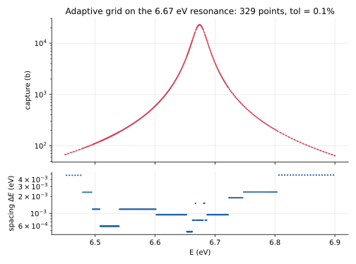
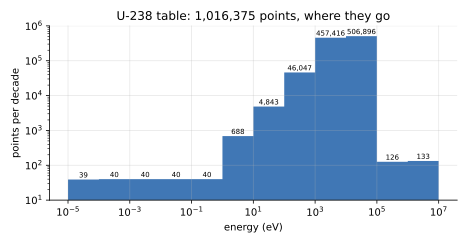

# From formulas to tables: pointwise reconstruction

Chapters 4–6 give $\sigma(E)$ as formulas. A transport code needs it as a
**table**: energies $E_i$ and values $\sigma_i$, with **linear interpolation**
in between. This chapter is about building such tables: where to put the
points, how accurate they are, and how the resolved range, the background and
the rest of the energy range fit together. In NJOY this is the job of the
RECONR module [[NJOY](#ref-njoy) ch. 3].

## Why linear tables

* **Speed.** Interpolating a table is a binary search plus one multiply–add,
  far cheaper than summing thousands of resonances, and it is done billions
  of times in transport and group averaging.
* **Exact integrals.** Integrals of linear segments with common weights
  ($1$, $1/E$, Maxwellians) have closed forms, so averages over a table carry
  no extra integration error.
* **Doppler broadening.** The standard broadening method assumes
  linear-linear data (chapter 8).
* **One format for everything.** Resonance-range values, MF3 sections with
  any interpolation law, and sums of reactions all end up on one grid.

## The midpoint test

Let $L(E)$ be the straight line through $(E_1, \sigma_1)$ and
$(E_2, \sigma_2)$. For a smooth function the interpolation error is

$$
\sigma(E) - L(E) = -\tfrac12\,\sigma''(\xi)\,(E - E_1)(E_2 - E),
$$

largest near the middle of the interval, where it is
$\tfrac18 h^2|\sigma''|$ with $h = E_2 - E_1$. So evaluating the true function
at the midpoint $E_m$ and comparing with the line is a good estimate of the
worst error in the interval. It is exact for a parabola. Halving the interval
divides the error by four. The **convergence criterion**, applied to every
reaction at once (elastic, capture, fission, ...), is

$$
\left|\sigma(E_m) - \tfrac12(\sigma_1 + \sigma_2)\right| \;\le\; \text{tol}\cdot|\sigma(E_m)| + \text{atol},
$$

with tol $= 10^{-3}$ (0.1%) and atol $= 10^{-5}$ b by default. The absolute
term stops the refinement from chasing cross sections that are negligibly
small.

The midpoint test is an estimate, not a bound. Between converged points the
error can slightly exceed tol where $\sigma''$ changes quickly. Random checks
on U-238 found the worst error at 0.098% for tol = 0.1%.

## The algorithm: depth-first bisection

```text
energies ← [seed₁];  values ← [σ(seed₁)]
for each next seed s:
    stack ← [(s, σ(s))]
    while stack not empty:
        (E₁, σ₁) ← last accepted point;  (E₂, σ₂) ← top of stack
        m ← (E₁ + E₂)/2
        if E₂ − E₁ > 10⁻⁹ E₂  and  σ(m) fails the midpoint test against (σ₁, σ₂):
            push (m, σ(m))            # refine the left half first
        else:
            accept (E₂, σ₂);  pop     # interval converged
```

The stack holds the pending right ends; the nearest is on top. The result
comes out sorted, so no merging is needed. NJOY's RECONR uses the same stack
logic [[NJOY](#ref-njoy) §3.3].



### Seeds

Bisection only looks at midpoints. A narrow resonance lying between two
points can be missed entirely if the midpoint happens to land on its smooth
wing. The refinement therefore starts from **seed** energies that are known to
matter:

* every resonance energy $E_r$, and $E_r \pm \Gamma_r/2$, $E_r \pm 3\Gamma_r$;
* every breakpoint of the relevant MF3 tables;
* 10 points per decade, so smooth regions start out sampled;
* the thermal energy 0.0253 eV and the range limits.

## Assembling the full energy range

For a nuclide with resonance parameters (LRP = 1), each reaction is

$$
\sigma(E) = \sigma^{\text{MF3}}(E) +
\begin{cases}
\sigma^{\text{res}}(E) & \text{inside the resolved range}\\
0 & \text{elsewhere}
\end{cases}
$$

where the resonance part (elastic, capture, fission) comes from the formalism
of the evaluation. In the **unresolved range** all the evaluations used here
set the flag LSSF = 1. It means MF3 already contains the *infinitely dilute*
average cross section: the average over many resonances weighted by a flat
flux [[ENDF-102](#ref-endf102) §2.3, §2.4.17]. Accounting for resonance
structure there (self-shielding) is left for later (chapter 10). Above the
unresolved range, MF3 is complete.

### Which reactions, and the total

The table holds the total MT1 and a non-redundant set of partials
(section 2.8): for U-238 the elastic, inelastic (sum), $(n,2n)$, $(n,3n)$,
fission, capture, and the MT5 and charged-particle partials. The total is
**rebuilt as the sum of the partials** at every point, as NJOY does, rather
than taken from the file. That makes the table self-consistent, which the raw
data is not always:

| Evaluation | MT1 vs. sum of partials |
| --- | --- |
| H-1 | $10^{-6}$ at its breakpoints, but **0.56%** between them: the total is stored lin-lin and capture log-log |
| B-10 | up to 0.19% at breakpoints |
| Zr-92 | up to 1.4% at breakpoints |
| U-235, U-238, O-16 | $\le 10^{-6}$ (7-digit rounding) |

### Discontinuities and shading

ENDF writes a jump as a repeated energy (the U-238 capture background jumps
at 20 keV, section 2.3). A linear table cannot hold two values at one energy.
The standard trick, also used by NJOY, is **shading**: the pair is split into
$E(1 - \delta)$ and $E(1 + \delta)$ with $\delta = 10^{-7}$, a nearly vertical
segment. The edges of the resolved range are treated the same way, since the
resonance contribution switches on and off there.

The pair must then be protected from bisection. Its midpoint lies exactly on
the jump, so the midpoint test always fails there, and refining it only puts
the repeated energy back on the grid. (A test caught exactly that.)

### Linearizing MF3

MF3 sections stored with log or histogram laws are linearized by the same
bisection, using the ENDF interpolation law as the "true" function. H-1
capture ($1/v$, stored log-log with a few points) needs extra points to be
represented linearly at 0.1%.

## Accuracy versus size

How many points a table needs depends on how hard the absolute floor atol
lets the refinement chase small cross sections. For U-238:

| atol (b) | points | capture RI (0.5 eV – 20 keV) | change |
| --- | --- | --- | --- |
| $10^{-5}$ | 1,015,934 | 274.3634 b | – |
| $10^{-4}$ | 862,039 | 274.3638 b | +1 ppm |
| $10^{-3}$ | 631,128 | 274.3668 b | +12 ppm |
| $10^{-2}$ | 397,383 | 274.3863 b | +83 ppm |

Most of the points serve features that hardly matter for a thermal reactor.
**63% of them resolve U-238's 2419 p-wave resonances**: tiny bumps, each a
real feature, that together move the resonance integral by less than
$10^{-4}$. Without the p-wave levels, the same reconstruction needs 378,000
points instead of 1,016,000.



NJOY addresses this with **thinning** [[NJOY](#ref-njoy) §3.3]. Panels are
first converged to a loose tolerance errmax (say 1%), and refined to the
strict tolerance err (0.1%) only while their contribution to the resonance
integral, $\tfrac12\,\Delta\sigma\,\Delta E / E$, exceeds a threshold errint.
Weak high-energy resonances end up with intermediate accuracy, and the
integral error stays controlled. That is a natural improvement for this
project if table size starts to matter. NJOY also rounds energies to 7 (or 9)
significant figures, so tables can be written in ENDF's 11-character fields.

## Integrals over a linear table

On a segment where $\sigma(E) = \sigma_1 + s\,(E - E_1)$ with slope
$s = (\sigma_2 - \sigma_1)/(E_2 - E_1)$, the $1/E$-weighted integral is exact:

$$
\int_{E_1}^{E_2} \sigma(E)\,\frac{\mathrm{d}E}{E}
= (\sigma_1 - s E_1)\ln\frac{E_2}{E_1} + s\,(E_2 - E_1).
$$

Summing it over the U-238 table gives the capture resonance integral: 274.36 b
from the resolved range and 0.92 b above it, **275.28 b** in total (published:
275 ± 3 b).

## Results for the pin-cell nuclides

Full-range tables (tol = 0.1%, atol = $10^{-5}$ b), built with the Rust
kernels:

| Nuclide | Resonances | Points | Reactions | Build time |
| --- | --- | --- | --- | --- |
| H-1 | none | 356 | 3 | 0.01 s |
| O-16 | none | 2,796 | 19 | 0.3 s |
| B-10 | none | 716 | 8 | 0.01 s |
| Zr-90 | MLBW, 113 | 24,854 | 34 | 0.9 s |
| Zr-91 | MLBW, 153 | 40,955 | 62 | 2.1 s |
| U-234 | MLBW, 119 | 55,104 | 8 | 0.5 s |
| U-235 | Reich–Moore, 3194 | 315,474 | 55 | 41 s |
| U-238 | Reich–Moore, 3345 | 1,016,375 | 10 | 87 s |

In Python alone the U-238 table would take about two hours; the Rust kernels
give the same grid point for point.

## Further reading

* [[NJOY](#ref-njoy)] ch. 3 (RECONR): unionization, the stack algorithm,
  significant-figure control, resonance-integral thinning (free).
* [[ENDF-102](#ref-endf102)] §2.3–2.4 on the unresolved range and LSSF
  (free).
* Code: [`reconstruct.py`](../../src/fission/endf/reconstruct.py)
  (`adaptive_grid`, `seed_grid`, `PointwiseXS`),
  [`pointwise.py`](../../src/fission/endf/pointwise.py) (full-range tables,
  shading, partials), [`reconstruct.rs`](../../rust/src/reconstruct.rs)
  (Rust port), and [`cache.py`](../../src/fission/endf/cache.py) (tables are
  cached on disk, keyed by data, parameters and code).
