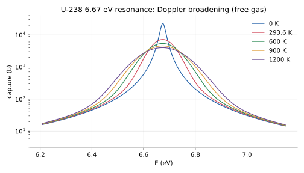
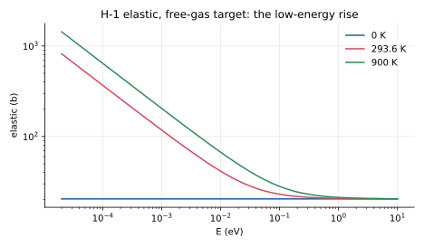
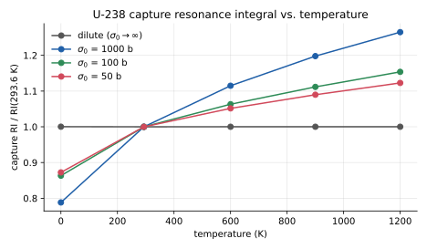

# Doppler broadening

The tables of chapter 7 describe a target nucleus **at rest**. In a reactor
the nuclei move: the fuel is at several hundred kelvin, hotter than the
moderator around it. A neutron of laboratory energy $E$ then meets the
nuclei at a spread of *relative* energies, and the cross section it sees is
the 0 K cross section averaged over that spread. Narrow resonances get lower
and wider; smooth cross sections hardly change. This chapter derives the
average, shows how to compute it exactly for a linear table, and looks at
what it does to the quantities that matter for a reactor. In NJOY this is the
job of the BROADR module [[NJOY](#ref-njoy) ch. 4].

## The reaction rate is what is averaged

A nuclear reaction only knows the relative velocity $\mathbf{u} = \mathbf{v} -
\mathbf{V}$ of neutron ($\mathbf{v}$) and nucleus ($\mathbf{V}$). An ENDF
cross section $\sigma_0$ is given for a nucleus at rest, so it is a function
of the relative speed, written as the laboratory energy a neutron would have
if the target stood still.

What can be averaged over the target motion is a **rate**. A neutron moving
through nuclei at density $N$ reacts with each one at rate $|\mathbf{v} -
\mathbf{V}|\,\sigma_0(|\mathbf{v} - \mathbf{V}|)\,N$. The effective cross
section $\bar\sigma$ is *defined* so that the familiar formula with the
neutron's own speed gives the same rate:

$$
v\,\bar\sigma(v) = \int |\mathbf{v}-\mathbf{V}|\;\sigma_0(|\mathbf{v}-\mathbf{V}|)\;
P(\mathbf{V})\,\mathrm{d}^3V .
$$

For a gas at temperature $T$ the target velocities are Maxwellian,
$P(\mathbf{V}) = (\beta/\pi)^{3/2} e^{-\beta V^2}$ with $\beta = M/(2k_BT)$,
where $M$ is the mass of the nucleus. This **free-gas model** is the standard
assumption of nuclear data processing. Atoms in a solid such as UO$_2$ are
bound in a lattice, but Lamb showed that for weak binding the absorption has
the same form as for a gas, at an *effective* temperature slightly above the
actual one
[[Lamb](#ref-lamb)].

## The exact free-gas kernel (derivation)

Change the integration variable to the relative velocity, $\mathbf{V} =
\mathbf{v} - \mathbf{u}$, and use spherical coordinates for $\mathbf{u}$
around the direction of $\mathbf{v}$, with $\mu$ the cosine of the angle
between them. Then $V^2 = v^2 + u^2 - 2vu\mu$, and the angular integral is
elementary:

$$
\int_{-1}^{1} e^{-\beta(v^2+u^2-2vu\mu)}\,\mathrm{d}\mu
= \frac{e^{-\beta(v-u)^2} - e^{-\beta(v+u)^2}}{2\beta v u}.
$$

What is left is a single integral over the relative speed:

$$
v\,\bar\sigma(v) = \left(\frac{\beta}{\pi}\right)^{3/2} 2\pi \int_0^\infty
u^2 \cdot u\,\sigma_0(u)\,
\frac{e^{-\beta(v-u)^2} - e^{-\beta(v+u)^2}}{2\beta v u}\,\mathrm{d}u .
$$

Speeds are naturally measured in units of the most probable target speed
$1/\sqrt\beta$. With the reduced speeds $y = \sqrt\beta\,v$ and $x =
\sqrt\beta\,u$, and because $\beta v^2 = (M/m)\,E/(k_BT)$, everything can be
written in terms of energies:

$$
\boxed{\;
\bar\sigma(y) = \frac{1}{y^2\sqrt\pi}\int_0^\infty x^2\,\sigma_0(x)
\left[e^{-(x-y)^2} - e^{-(x+y)^2}\right]\mathrm{d}x,
\qquad y^2 = \alpha E,\quad x^2 = \alpha E',\quad \alpha = \frac{\text{AWR}}{k_BT}.\;}
$$

This is the **exact free-gas kernel** (often attributed to Solbrig
[[Solbrig](#ref-solbrig)]): exact for a Maxwellian gas, with no assumption on
the shape of $\sigma_0$. Two remarks:

* The second exponential is the contribution of nuclei moving *towards* the
  neutron fast enough to reverse the relative motion. It only matters when
  $y$ is small, i.e. at energies of the order of $k_BT/\text{AWR}$
  ($1.07\times10^{-4}$ eV for U-238 at 293.6 K).
* The Gaussian $e^{-(x-y)^2}$ makes everything beyond $|x - y| \approx 6$
  negligible ($e^{-36} \approx 2\times10^{-16}$). Only relative energies
  within a few **Doppler widths** of $E$ contribute.

## The Doppler width and the ψ function

Away from the lowest energies ($E \gg k_BT/\text{AWR}$), expand around
$E' = E$: $x - y = \sqrt\alpha(\sqrt{E'} - \sqrt{E}) \approx (E' -
E)/\Gamma_D$, with the **Doppler width**

$$
\Gamma_D = 2\sqrt{\frac{E\,k_BT}{\text{AWR}}} .
$$

The kernel becomes a normalized Gaussian in energy:

$$
\bar\sigma(E) \approx \frac{1}{\Gamma_D\sqrt\pi}\int \sigma_0(E')\,
e^{-\left(\frac{E'-E}{\Gamma_D}\right)^2}\mathrm{d}E' .
$$

For U-238 at 6.67 eV, $\Gamma_D$ is 0.054 eV at 293.6 K and 0.094 eV at
900 K, against a natural width $\Gamma = \Gamma_n + \Gamma_\gamma = 0.0242$
eV. At 1 keV and 900 K it is 1.1 eV, larger than many resonance spacings.

Broadening an SLBW Lorentzian $\sigma_0 = \sigma_{\text{peak}}/(1+X^2)$, with
$X = 2(E-E_r)/\Gamma$, with this Gaussian gives the classic **ψ function**
of Bethe and Placzek [[Bell & Glasstone](#ref-bell) §8.1d;
[Fröhner](#ref-frohner) §3.5]:

$$
\bar\sigma = \sigma_{\text{peak}}\,\psi(X, \xi),\qquad
\psi(X, \xi) = \frac{\xi}{2\sqrt\pi}\int_{-\infty}^{\infty}
\frac{e^{-\xi^2(X - t)^2/4}}{1 + t^2}\,\mathrm{d}t,\qquad \xi = \frac{\Gamma}{\Gamma_D}.
$$

At the peak it has a closed form,
$\psi(0, \xi) = \tfrac{\sqrt\pi}{2}\,\xi\,e^{\xi^2/4}\operatorname{erfc}(\xi/2)$,
with two limits:

* $\xi \gg 1$ (resonance much wider than $\Gamma_D$): $\psi \to 1$, nothing
  changes. The 0.27 eV level of U-235 has $\Gamma = 0.164$ eV against
  $\Gamma_D = 0.019$ eV at 900 K; its peak drops by only 1.5%.
* $\xi \ll 1$ (narrow resonance): $\psi(0,\xi) \to \tfrac{\sqrt\pi}{2}\xi$.
  The peak falls like $1/\Gamma_D \propto 1/\sqrt T$, and the resonance
  takes the Gaussian shape of the Doppler spread.

The 6.67 eV resonance of U-238 is in between. The table compares the
single-level ψ estimate, using the evaluation's own widths, with the exact
free-gas broadening of the Reich–Moore table:

| T (K) | $\Gamma_D$ (eV) | $\xi$ | $\psi(0,\xi)$ | $22{,}765\ \text{b}\times\psi$ | computed peak |
| --- | --- | --- | --- | --- | --- |
| 293.6 | 0.0535 | 0.452 | 0.316 | 7,195 b | 7,195 b |
| 600 | 0.0765 | 0.316 | 0.237 | 5,387 b | 5,385 b |
| 900 | 0.0937 | 0.258 | 0.199 | 4,532 b | 4,531 b |
| 1200 | 0.1082 | 0.224 | 0.176 | 3,996 b | 3,996 b |

Agreement to better than 0.05%: for an isolated, nearly Breit–Wigner level
the ψ function is an excellent approximation. Even at room temperature the
peak is only a third of its 0 K value.

## Properties of the broadened cross section

**The area is conserved.** In the Gaussian approximation $\bar\sigma$ is a
convolution with a normalized kernel, so $\int\bar\sigma\,\mathrm{d}E =
\int\sigma_0\,\mathrm{d}E$. Numerically, the capture area of the 6.67 eV
resonance stays at 849.9 b eV between 0 and 1200 K (to 0.06%, the rest is
the integration window), and the dilute capture resonance integral of U-238
moves from 275.28 b at 0 K to 275.24 b at 293.6 K, and then by at most
0.01 b up to 1200 K.
This is the "integrated capture" of section 4.3, which Doppler broadening
leaves alone.

**A 1/v cross section does not change.** If $\sigma_0 \propto 1/u$, the
reaction rate $u\sigma_0(u)$ is a constant and cannot depend on how the
targets move. In the formula: $x^2\sigma_0 \propto x$, and

$$
\int_0^\infty x\left[e^{-(x-y)^2} - e^{-(x+y)^2}\right]\mathrm{d}x
= \int_{-\infty}^{\infty} x\,e^{-(x-y)^2}\,\mathrm{d}x = \sqrt\pi\,y,
$$

so $\bar\sigma \propto 1/y$, the same 1/v law. That is why every thermal
capture value of chapter 1 is unchanged by temperature (U-238: 2.6824 b at
0 K, 2.6835 b at 1200 K; H-1: 0.3326 b), while the U-235 fission value,
whose 0.27 eV resonance is not far away, moves by 0.1%.

**A constant cross section rises at low energy.** For $\sigma_0 =$ const the
integral is elementary:

$$
\bar\sigma(y) = \sigma_0\left[\left(1 + \frac{1}{2y^2}\right)\operatorname{erf}(y)
+ \frac{e^{-y^2}}{y\sqrt\pi}\right].
$$

When the neutron is slow compared with the targets ($y \ll 1$), the relative
speed is set by the target motion alone, so the reaction rate is constant
and $\bar\sigma \propto 1/v$. For hydrogen the effect is large: the free-gas
H-1 elastic cross section at 0.0253 eV is 30.1 b at 293.6 K instead of
20.4 b. Hydrogen in water is not a free gas, though; its thermal scattering
comes from $S(\alpha,\beta)$ data (chapter 11).

A fourth property makes a good test: **temperatures add**. A Maxwellian
convolved with a Maxwellian is a Maxwellian, so broadening to 300 K and then
by another 600 K gives the 900 K result.

## Exact broadening of a linear table

Our 0 K table is linear in $E$ between its points, i.e. $\sigma_0$ is linear
in $x^2$ on each segment. The integral is linear in $\sigma_0$, so the
broadened value at any energy is a **fixed weighted sum of the table
values**:

$$
\bar\sigma(y) = \sum_i w_i(y)\,\sigma_i ,
$$

and the same weights serve every reaction. (The broadened total therefore
remains the sum of the broadened partials.) Only the points within
$|x - y| < 6$ have nonzero weights.

**The closed form.** Cullen and Weisbin showed that each segment can be
integrated analytically [[Cullen & Weisbin](#ref-cullen)]. With $\sigma_0 =
A + Bx^2$ on a segment and the substitution $z = x \mp y$, the integrand
becomes a polynomial in $z$ times $e^{-z^2}$, and everything reduces to

$$
F_k(a) = \int_a^\infty z^k e^{-z^2}\,\mathrm{d}z:\qquad
F_0 = \tfrac{\sqrt\pi}{2}\operatorname{erfc}(a),\quad
F_1 = \tfrac12 e^{-a^2},\quad
F_k = \tfrac{k-1}{2}F_{k-2} + \tfrac12 a^{k-1}e^{-a^2}.
$$

The integral over a segment $[a, b]$ is a combination of the differences
$F_k(a) - F_k(b)$. This is the method of NJOY's BROADR.

**Quadrature instead.** Resonance tables contain many extremely narrow
segments: shaded discontinuities are $10^{-7}$ wide, and typical segments
are $10^{-3}$–$10^{-2}$ in $x$. There, $F_k(a) - F_k(b)$ is the difference
of two nearly equal numbers and loses most of its digits. This code
integrates each segment by Gauss–Legendre quadrature instead. The integrand
is a polynomial times a Gaussian, so the $n$-point error falls like
$h^{2n+1}$ with the panel width $h$:

* 2 points for $h \le 0.01$, 4 points for $h \le 0.1$, 8 points on panels of
  at most 0.5. Each choice reaches about $10^{-14}$.
* No error function is needed, which keeps the Rust port free of special
  functions.
* The closed form is kept as an independent check; the two agree to
  $10^{-11}$.

Outside the table, $\sigma_0$ is extended as 1/v below the first point
($10^{-5}$ eV) and as a constant above the last one.

## Building a table at temperature T

Each broadened value costs an integral over every 0 K segment within a few
Doppler widths, from a handful at thermal energies to almost 3000 for U-238
near 10 keV. The new table is built in three steps:

1. **Seeds.** Start from the 0 K energies. Where the 0 K points are far
   apart compared with $\Gamma_D$, add points at $\pm1$, $\pm2$ and
   $\pm3\,\Gamma_D$ around each of them (see below).
2. **Refine** with the midpoint test of chapter 7, now applied to
   $\bar\sigma(E)$. This adds points where the broadened curve bends more
   than the 0 K one, e.g. in the low-energy rise shown above.
3. **Thin.** The broadened curve is smoother than the 0 K curve, so many 0 K
   points become redundant. Starting from a kept point, extend a straight
   chord as far as every skipped point stays within tolerance of it, keep
   the end point, and repeat.

**Why the extra seeds.** Between two 0 K points far apart, the broadened
curve is the straight 0 K segment with its two corners rounded over a few
$\Gamma_D$. If one corner is concave and the other convex, as on a ramp
between two plateaus, the broadened values at the two ends shift by nearly
equal and opposite amounts. The chord through them then passes the midpoint
test, although it is wrong near both ends. The first version of this code
fell into exactly that trap in the unresolved range of U-235 (0 K points
10 eV apart, $\Gamma_D \approx 1$ eV at 2.4 keV), with errors of 2.4%. Since
the rounding decays like $e^{-(\Delta E/\Gamma_D)^2}$, seeds out to
$3\Gamma_D$ make the refinement look where it matters.

**Accuracy and size.** Checked against the exact broadened function at 4000
random energies per table, the worst error is 1.0–1.5 times the tolerance
(tol = 0.1%, atol = $10^{-5}$ b). As in chapter 7, the midpoint test
estimates the error rather than bounding it, and thinning adds a little.
Hot tables are much smaller than cold ones:

| Nuclide | 0 K | 293.6 K | 600 K | 900 K | 1200 K |
| --- | --- | --- | --- | --- | --- |
| U-238 | 1,016,375 | 229,856 | 166,306 | 136,065 | 117,017 |
| U-235 | 315,474 | 60,028 | 42,008 | 34,407 | 29,905 |
| Zr-91 | 40,955 | 29,532 | 27,241 | 25,848 | 24,753 |

Most of the 0 K points of U-238 resolve narrow p-wave resonances (section
7.5), which broadening smears into the background. A U-238 table takes 10 to
18 s on 16 cores in Rust; the Python reference would need hours.

## Why reactor physics cares: the Doppler effect

Broadening conserves the area of each resonance, so it does not change the
**infinitely dilute** resonance integral. It does change the capture rate in
a real fuel pin, where the flux dips inside strong resonances
(self-shielding, chapter 11). A preview with the narrow-resonance flux
$\phi(E) \propto 1/[E(\sigma_t(E) + \sigma_0)]$, where $\sigma_0$ is the
background cross section per U-238 atom, gives the **effective resonance
integral** $\int \sigma_\gamma\,\sigma_0/(\sigma_t + \sigma_0)\,\mathrm{d}E/E$
(0.5 eV – 20 keV):

| T (K) | dilute | $\sigma_0$ = 1000 b | $\sigma_0$ = 100 b | $\sigma_0$ = 50 b |
| --- | --- | --- | --- | --- |
| 0 | 274.36 b | 56.2 b | 19.17 b | 13.52 b |
| 293.6 | 274.32 b | 71.3 b | 22.21 b | 15.50 b |
| 600 | 274.32 b | 79.5 b | 23.61 b | 16.30 b |
| 900 | 274.32 b | 85.4 b | 24.69 b | 16.89 b |
| 1200 | 274.33 b | 90.2 b | 25.63 b | 17.40 b |

Where the resonance is strongly self-shielded, its peak hardly matters,
because the flux there is already near zero. What matters is how much of the
resonance lies in the region where the cross section is comparable with
$\sigma_0$. Broadening lowers the peak but widens the resonance into that
region, so the shielded capture **increases with temperature**: by 9% from
293.6 K to 900 K at $\sigma_0 = 50$ b. Hotter fuel absorbs more neutrons in
U-238 without fissioning, which reduces the reactivity: the **fuel
temperature (Doppler) coefficient**. It acts as soon as the fuel heats up,
before the moderator does, and is the main prompt negative feedback of a
light-water reactor [[Bell & Glasstone](#ref-bell) §8.3e].

## Further reading

* [[NJOY](#ref-njoy)] ch. 4 (BROADR): broadening of linear tables with the
  Cullen–Weisbin method, thinning (free).
* [[Fröhner](#ref-frohner)] §3.5: Doppler broadening (free).
* [[Bell & Glasstone](#ref-bell)] §8.1d (Doppler broadening of resonances)
  and §8.3e (Doppler effect on resonance absorption) (free).
* [[Cullen & Weisbin](#ref-cullen)], the exact method for tabulated data;
  [[Solbrig](#ref-solbrig)], the exact kernel; [[Lamb](#ref-lamb)], nuclei
  bound in a crystal (not free).
* Code: [`doppler.py`](../../src/fission/processing/doppler.py) (kernel,
  weights, closed form, seeds, thinning, `broaden_table`),
  [`doppler.rs`](../../rust/src/doppler.rs) (Rust port),
  [`cache.py`](../../src/fission/processing/cache.py) (tables cached by
  temperature; `make doppler-tables`), and `make doppler NUC=U238 E=6.674`
  for a quick look at one resonance.
