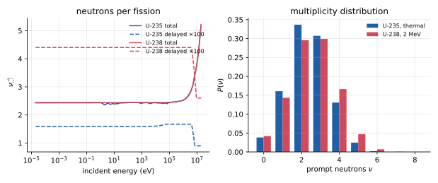
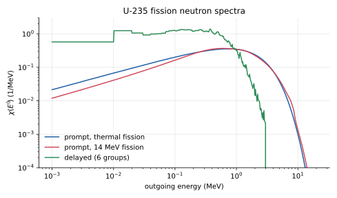
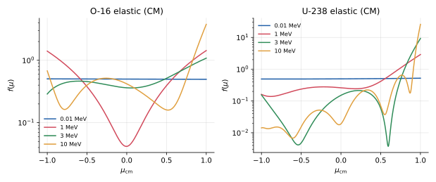
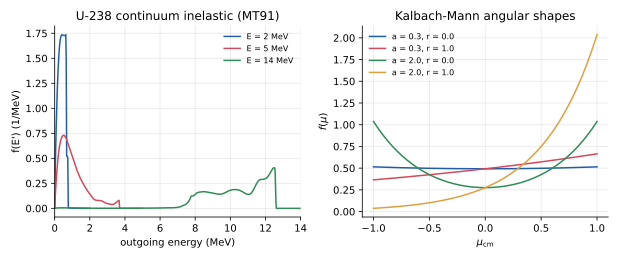

# What comes out: secondary neutrons

Chapters 4–8 answer one question: *how likely* is a reaction, $\sigma(E)$. A
transport calculation also needs to know what each reaction *produces*: how
many neutrons, at what energies, in which directions. For every reaction that
emits neutrons, the ENDF file gives the ingredients of the **double
differential cross section**

$$
\sigma(E \to E', \mu) = \sigma(E)\; y(E)\; f(\mu, E \to E'),
$$

where $y$ is the number of neutrons emitted per reaction (the **yield** or
**multiplicity**) and $f$ is their distribution in outgoing energy $E'$ and
scattering cosine $\mu$, normalized to 1 [[ENDF-102](#ref-endf102) §4–6].
Group averaging (the next step of this project) turns these into the scattering
matrices and fission spectra of a multigroup calculation. This chapter covers
what the ingredients mean and how ENDF stores them.

| Data | ENDF file | Pin-cell nuclides |
| --- | --- | --- |
| $\bar\nu$ (neutrons per fission), delayed groups | MF1 MT452/455/456 | U-234, U-235, U-238 |
| angular distributions $f(\mu, E)$ | MF4 | elastic of all; discrete inelastic of O, Zr, U-238, B |
| energy distributions $f(E \to E')$ | MF5 | prompt fission spectra (MT18), delayed spectra (MT455) |
| energy–angle distributions | MF6 | inelastic continuum, $(n,2n)$, $(n,3n)$, discrete levels of U-234/235 |

## Neutrons per fission

Each fission releases on average $\bar\nu$ neutrons, the number that makes a
chain reaction possible. ENDF splits it into **prompt** neutrons, emitted
by the excited fragments immediately after scission, and **delayed**
neutrons, emitted seconds to a minute later [[ENDF-102](#ref-endf102) §1.2–1.4]:

$$
\bar\nu_t(E) = \bar\nu_p(E) + \bar\nu_d(E) \qquad \text{(MT452 = MT456 + MT455)}.
$$

| | E | $\bar\nu_t$ | $\bar\nu_p$ | $\bar\nu_d$ | $\beta = \bar\nu_d/\bar\nu_t$ |
| --- | --- | --- | --- | --- | --- |
| U-235 | 0.0253 eV | 2.4299 | 2.4140 | 0.01585 | 0.652% |
| U-235 | 1 MeV | 2.5178 | 2.5011 | 0.01670 | 0.663% |
| U-235 | 14 MeV | 4.4063 | 4.3973 | 0.00900 | 0.204% |
| U-238 | 1 MeV | 2.5296 | 2.4856 | 0.04400 | 1.739% |

$\bar\nu$ grows with the incident energy: the extra energy ends up as
excitation of the fragments, which they shed by emitting more neutrons. In
the resolved resonance range of U-235 the evaluation even gives $\bar\nu$ a
small structure from level to level. The sum rule holds in the files to the
six digits they are written with.

**The multiplicity distribution.** $\bar\nu$ is an average; an individual
fission emits 0, 1, 2, ... neutrons. ENDF/B-VIII.1 stores the probabilities
$P(\nu, E)$ for U-235 and U-238 in MF6 MT18, in a form described in
[[ENDF-102](#ref-endf102) §6.3.9]: each "product" $\nu = 0 \dots 14$ carries
$\tilde P(\nu, E) = P(\nu, E)/\bar\nu_p(E)$ as its yield (with LAW = −5,
meaning "spectrum in MF4/MF5"). Two sum rules follow,
$\sum_\nu \nu\,\tilde P = 1$ and $\sum_\nu \tilde P = 1/\bar\nu_p$. For thermal
fission of U-235, $P(\nu) = 0.038, 0.161, 0.337, 0.307, 0.131, 0.025, 0.002$
for $\nu = 0 \dots 6$: almost 4% of fissions emit no neutron at all.

The first sum rule holds to $10^{-7}$. The second does not quite: the
$\bar\nu_p$ implied by the distribution differs from MT456 by up to 1.2%
(U-235) and 1.9% (U-238) at the tabulated energies. The shape is consistent,
the normalization is not, so this code uses only the normalized $P(\nu)$ and
takes $\bar\nu$ from MF1. $P(\nu)$ matters for noise and
coincidence-counting methods, not for the average quantities of a lattice
calculation.

## Delayed neutrons

Some fission products beta-decay into a nucleus excited above its neutron
separation energy, which then emits a
neutron at once. The neutron appears with the half-life of the beta decay.
ENDF lumps the hundreds of such **precursors** into six families, each with a
decay constant $\lambda_i$ (MF1 MT455), an abundance $a_i$ and an energy
spectrum (both in MF5 MT455, one partial distribution per family):

| Family | 1 | 2 | 3 | 4 | 5 | 6 |
| --- | --- | --- | --- | --- | --- | --- |
| half-life (s) | 51.98 | 21.17 | 5.74 | 2.29 | 0.82 | 0.24 |
| abundance $a_i$ | 0.035 | 0.181 | 0.173 | 0.387 | 0.159 | 0.066 |
| mean energy (keV) | 405 | 472 | 443 | 557 | 518 | 540 |

(U-235, thermal fission.) Two properties matter for reactor physics:

* **Delay.** The mean precursor lifetime is $\sum_i a_i/\lambda_i = 11.1$ s.
  Only 0.65% of the neutrons are delayed, but weighted by their lifetime they
  set the time scale of the chain reaction, which makes a reactor
  controllable. This is the subject of reactor kinetics.
* **Energy.** Delayed neutrons are born with about 0.4–0.56 MeV on average,
  much less than prompt neutrons. They are less likely to cause fast fission
  in U-238 and more likely to stay in the core, so their *effective* fraction
  differs from $\beta$.

## The fission spectrum

Prompt neutrons are evaporated from fragments that fly apart at high speed.
In the fragment's frame the spectrum is roughly Maxwellian; transformed to
the laboratory frame it becomes broader, which is the origin of the Watt and
Madland–Nix forms (ENDF laws LF = 11 and 12) [[ENDF-102](#ref-endf102)
§5.1]. ENDF/B-VIII.1 gives the actinide spectra as tables instead (LF = 1),
$\chi(E \to E')$ at a list of incident energies.

For thermal fission of U-235 the prompt spectrum has its maximum at 0.72 MeV
and a mean of 2.000 MeV; 31% of the neutrons are born below 1 MeV and 0.14%
above 10 MeV. For 14 MeV fission the mean is 2.080 MeV: the spectrum depends
only weakly on what caused the fission. Every spectrum in the files is
normalized to $10^{-6}$ or better, except U-238 at 20 MeV, which integrates
to 1.0003.

## Elastic scattering: angles and kinematics

Elastic scattering is a two-body collision, so its outgoing energy is fixed
by the angle. In the **centre-of-mass (CM) frame**, the neutron and the
nucleus (mass ratio $A$) approach and leave with unchanged speeds; only the
direction changes, by an angle with cosine $\mu_{cm}$. Going back to the
**laboratory frame** gives

$$
E' = E\,\frac{A^2 + 2A\mu_{cm} + 1}{(A+1)^2},
\qquad
\mu_{lab} = \frac{1 + A\mu_{cm}}{\sqrt{A^2 + 2A\mu_{cm} + 1}} .
$$

The neutron keeps between $\alpha E$ and $E$, with
$\alpha = \left(\frac{A-1}{A+1}\right)^2$. The average loss of lethargy
per collision, for scattering isotropic in the CM frame, is
$\xi = 1 + \frac{\alpha\ln\alpha}{1-\alpha}$, and slowing down from 2 MeV
to 1 eV takes about $\ln(2\times10^6)/\xi$ collisions:

| Nuclide | $\alpha$ | $\xi$ | collisions 2 MeV → 1 eV | $\bar\mu_{lab}$ at 1 eV | $2/(3A)$ |
| --- | --- | --- | --- | --- | --- |
| H-1 | 0 | 1.000 | 15 | 0.6672 | 0.6672 |
| O-16 | 0.777 | 0.121 | 120 | 0.0420 | 0.0420 |
| Zr-90 | 0.956 | 0.022 | 651 | | |
| U-238 | 0.983 | 0.0085 | 1717 | 0.0029 | 0.0028 |

(For U-238 the data's CM distribution is not quite isotropic even at 1 eV,
$\bar\mu_{cm} = 4\times10^{-5}$, hence the small difference.)

Hydrogen is the ideal moderator: it can absorb all of a neutron's energy in
one collision. The average lab cosine of isotropic CM scattering is exactly
$2/(3A)$ (average $\mu_{lab}$ over $\mu_{cm}$), so even scattering that is
isotropic for the nucleus is forward-peaked in the laboratory when the
target is light. The last two columns show the code recovering it from the
ENDF angular data and the kinematics.

**Angular distributions** are given in MF4 (or in MF6 LAW = 2), usually in
the CM frame, as Legendre coefficients:

$$
f(\mu, E) = \sum_{l=0}^{NL} \frac{2l+1}{2}\, a_l(E)\, P_l(\mu), \qquad a_0 = 1,
$$

so that $a_l = \int f P_l\,\mathrm{d}\mu$ are the **moments** of the
distribution and $a_1 = \bar\mu$. Transport codes use exactly these moments
(the $P_1$, $P_3$, ... scattering matrices), which is why ENDF prefers this
form. At low energy only s-waves scatter, so the CM distribution is
isotropic. As the energy rises, higher partial waves interfere and the
distribution becomes forward-peaked with diffraction minima, like light
diffracted by a disc. U-238 has $\bar\mu_{lab} = 0.47$ at 1 MeV and 0.87 at
10 MeV; at 10 MeV most elastically scattered neutrons barely change
direction.

## Inelastic scattering

In **inelastic** scattering the nucleus is left excited. For a discrete level
at energy $E_x$ the reaction is still two-body, with $Q = -E_x$; the CM
energy of the outgoing neutron is

$$
E'_{cm} = \frac{A}{A+1}\left(\frac{A}{A+1}E + Q\right),
$$

and the reaction is possible above the **threshold**
$E_{th} = -Q\,(A+1)/A$, where the CM energy is just enough to excite the
level. ENDF numbers the levels MT51, 52, ... (MT91 is the unresolved
continuum above them):

| Nuclide | first level $E_x$ | threshold | $(n,2n)$ threshold |
| --- | --- | --- | --- |
| U-238 | 44.9 keV | 45.1 keV | 6.18 MeV |
| Zr-90 | 1.761 MeV | 1.781 MeV | 12.1 MeV |
| O-16 | 6.049 MeV | 6.431 MeV | 16.7 MeV |

The heavy, deformed U-238 has a rotational level at only 45 keV, so
inelastic scattering already contributes to slowing down in the keV range.
A neutron that scatters inelastically loses at least the level energy; in an
elastic collision with U-238 it loses at most $1 - \alpha = 1.7\%$.
Oxygen, a doubly magic nucleus, has no level below 6 MeV.

## Continuum emission

At higher energies the levels are too dense to list. The outgoing neutrons
then form a continuous spectrum (MF6 LAW = 1), tabulated as
$f(\mu, E \to E')$ at a grid of incident energies [[ENDF-102](#ref-endf102)
§6.2.3]. Two physical processes contribute:

* **Evaporation.** The neutron is captured, its energy is shared among all
  nucleons (the compound nucleus of chapter 3), and one neutron eventually
  "boils off" with a roughly Maxwellian spectrum, isotropically (symmetric
  about 90° in the CM).
* **Pre-equilibrium emission.** A fast neutron can be knocked out before the
  energy is shared. Such neutrons are more energetic and remember the
  incident direction: they are forward peaked.

The angular part is given as Legendre coefficients (LANG = 1) or by the
**Kalbach–Mann systematics** (LANG = 2), a two-parameter form that captures
both processes [[Kalbach](#ref-kalbach)]:

$$
f(\mu, E \to E') = f_0(E \to E')\;\frac{a}{2\sinh a}
\left[\cosh(a\mu) + r\,\sinh(a\mu)\right].
$$

The evaluator gives the energy spectrum $f_0$ and the **pre-compound
fraction** $r$ (0 = pure evaporation, symmetric; 1 = pure pre-equilibrium,
forward). The slope $a(E, E')$ follows from Kalbach's systematics. It grows
with the emission energy: for U-238 at 14 MeV, $a = 0.23$ for a 0.1 MeV
neutron and 0.65 for a 10 MeV one. The average cosine is
$r(\coth a - 1/a)$.

The U-238 spectra show a subtlety of reaction bookkeeping. MT91 is the
inelastic scattering in which the residual nucleus only emits gamma rays.
If the neutron left enough energy behind for the residual nucleus to emit a
second neutron $(n,2n)$ or to fission $(n,n'f)$, the event would belong to
another MT. So at 14 MeV the MT91 neutrons are the *energetic* ones: the
spectrum lies between about 7 and 12.5 MeV, with a mean of 10.4 MeV, against 0.40 MeV at 2 MeV
incident and 1.05 MeV at 5 MeV. The $(n,2n)$ neutrons at 14 MeV average
1.9 MeV each, with yield 2.

**Interpolation between incident energies.** Where the range of $E'$ moves
with $E$ (it ends near $E - E_{th}$), interpolating two spectra at fixed $E'$
would add a spectrum ending at $E'_1$ to one ending at $E'_2$ and produce a
spurious step. ENDF's **unit-base** interpolation (INT = 22) instead maps
both spectra onto $x = (E' - E'_{low})/(E'_{high} - E'_{low}) \in [0, 1]$,
interpolates at fixed $x$, and maps back with the Jacobian
$\mathrm{d}x/\mathrm{d}E'$, which preserves the normalization
[[ENDF-102](#ref-endf102) §0.5.2]. All the Legendre continuum data of the pin-cell
nuclides use it. Quantities that are not densities, such as Kalbach's $r$,
are interpolated at fixed $x$ without the Jacobian.

## What the reader checks

All MF4, MF5 and MF6 sections of the twelve pin-cell nuclides are read
(neutron products only). The tests verify the physics, not just the parsing:

* $\bar\nu_t = \bar\nu_p + \bar\nu_d$; six delayed families with abundances
  summing to 1 and spectra much softer than the prompt one;
* every energy distribution is normalized (to $10^{-4}$; see above for the
  one exception at $3\times10^{-4}$), and every Kalbach–Mann distribution
  integrates over angle to its $f_0$;
* the lab mean cosine of H-1 elastic scattering is $2/(3A)$ to $10^{-4}$;
  elastic distributions are non-negative at all tabulated energies;
* unit-base interpolation keeps spectra normalized and equals ordinary
  interpolation when the ranges coincide (the two properties ENDF-102 states).

## Further reading

* [[ENDF-102](#ref-endf102)] §1.2–1.4 ($\bar\nu$, delayed neutrons), §4
  (angular distributions), §5 (energy distributions, including the Watt and
  Madland–Nix forms), §6.2.3 (continuum and Kalbach–Mann), §6.3.9 (the
  multiplicity distribution), §0.5.2 (unit-base interpolation) (free).
* [[Kalbach](#ref-kalbach)], the systematics of continuum angular
  distributions (not free).
* [[MIT 22.05](#ref-mit2205)]: neutron kinematics, slowing down and delayed
  neutrons in lecture form (free); [[Lamarsh](#ref-lamarsh)] ch. 3,
  [[Duderstadt & Hamilton](#ref-dh)] ch. 2 (not free).
* Code: [`distributions/`](../../src/fission/endf/distributions/):
  [`nu.py`](../../src/fission/endf/distributions/nu.py),
  [`angular.py`](../../src/fission/endf/distributions/angular.py),
  [`energy.py`](../../src/fission/endf/distributions/energy.py),
  [`mf6.py`](../../src/fission/endf/distributions/mf6.py),
  [`kinematics.py`](../../src/fission/endf/distributions/kinematics.py),
  [`incident.py`](../../src/fission/endf/distributions/incident.py). Try
  `make secondary NUC=U235`.
