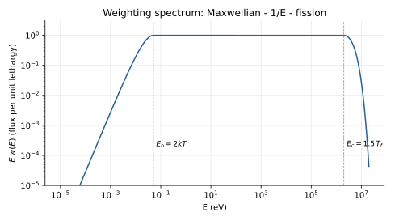
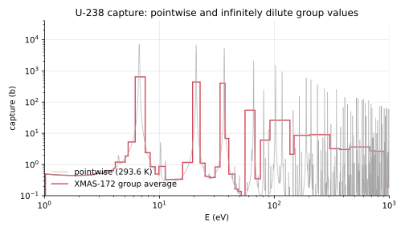
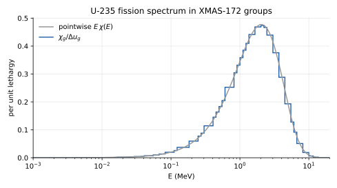
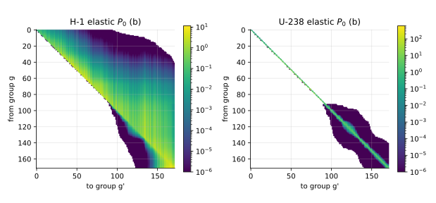

# Multigroup constants

Everything so far describes cross sections as functions of a continuous
energy. Deterministic transport codes (and the MOC solver of this project)
work with a few hundred **energy groups** instead: within each group a
cross section is a single number. This chapter shows how to choose those
numbers so that reaction rates are preserved, and how this code computes them
from the pointwise tables and the secondary-neutron data of chapters 7–9. In
NJOY this is the job of GROUPR [[NJOY](#ref-njoy) ch. 8].

## Why group averages are flux weighted

Integrate the transport equation over the energies of group $g$,
$[E_{g+1}, E_g]$. Every term becomes a group quantity, for example the
collision rate

$$
\int_g \Sigma_t(E)\,\phi(E)\,\mathrm{d}E = \Sigma_{t,g}\,\phi_g,
\qquad
\phi_g = \int_g \phi(E)\,\mathrm{d}E,
\qquad
\Sigma_{t,g} = \frac{\int_g \Sigma_t(E)\,\phi(E)\,\mathrm{d}E}{\int_g \phi(E)\,\mathrm{d}E}.
$$

With this definition the multigroup equations reproduce the reaction rates
of the continuous-energy problem *exactly*, but only if the flux $\phi(E)$
inside each group is known, which is what the transport calculation is
supposed to find. In practice the averages are taken with an assumed
**weighting spectrum** $w(E)$ that has the right shape within each group
(its overall level cancels). Two errors follow from that choice:

* **Spectral shape.** If the real spectrum differs from $w$ inside a group,
  the average is slightly off. Fine groups make this error small.
* **Self-shielding.** Inside a strong resonance the real flux dips
  (chapter 8, section 8.7); a smooth $w$ ignores the dip and gives the
  **infinitely dilute** group cross section, too large for a fuel pin.
  Correcting this is the self-shielding step of the roadmap; the libraries of
  this chapter are its starting point.

## The group structure

Groups are numbered from the highest energy down (group 0 is the fastest),
the convention of reactor physics. This code uses the **XMAS 172-group**
structure, designed for light-water reactor lattice calculations, with its
boundaries copied from NJOY2016 (GROUPR, `ign = 18`). It runs from
$10^{-5}$ eV to 19.64 MeV, a lethargy span of 28.3:

* 80 groups below 4 eV, where the thermal spectrum and the low resonances of
  U-235 and Pu need resolving;
* 47 groups from 4 eV to 9.12 keV, where the large U-238 resonances lie.
  The 6.67 eV resonance sits alone in the group 6.16–7.52 eV;
* about 45 groups above, coarser where cross sections are smooth.

The widths range from 0.0096 to 5.7 in lethargy.

## The weighting spectrum

The library uses NJOY's analytic weight (GROUPR option `iwt = 4`), three
physical regimes joined continuously:

$$
w(E) =
\begin{cases}
a_b\,E\,e^{-E/kT} & E \le E_b \quad \text{(thermal Maxwellian)}\\
1/E & E_b < E \le E_c \quad \text{(slowing down, chapter 1)}\\
a_c\,\sqrt{E}\,e^{-E/T_f} & E > E_c \quad \text{(fission spectrum)}
\end{cases}
$$

NJOY leaves the joints $E_b$, $E_c$ to the user. Here they are where the
logarithmic slopes also agree, so that $w$ has no kinks:
$\mathrm{d}\ln w/\mathrm{d}\ln E = 1 - E/kT = -1$ gives $E_b = 2kT$ (also
NJOY's choice in its `iwt = 6` option), and $\tfrac12 - E/T_f = -1$ gives
$E_c = 1.5\,T_f$. The thermal temperature is that of the library, and
$T_f = 1.3335$ MeV makes the Maxwellian mean $1.5\,T_f$ equal to the
2.0002 MeV mean of the U-235 thermal fission spectrum (chapter 9).

## Cross sections, $\nu\sigma_f$ and $\nu$

For every reaction in the pointwise table,
$\sigma_g = \int_g \sigma w\,\mathrm{d}E / \int_g w\,\mathrm{d}E$, and for
fission also

$$
(\nu\sigma_f)_g = \frac{\int_g \bar\nu(E)\,\sigma_f(E)\,w(E)\,\mathrm{d}E}{\int_g w\,\mathrm{d}E},
\qquad
\bar\nu_{p,g} = \frac{\int_g \bar\nu_p\,\sigma_f\,w\,\mathrm{d}E}{\int_g \sigma_f\,w\,\mathrm{d}E}.
$$

Some values at 293.6 K make the averaging concrete:

* **U-235 thermal group** (0.025–0.03 eV): $\sigma_f = 561.3$ b, against
  586.2 b at exactly 0.0253 eV. The group lies slightly above 0.0253 eV, where
  a 1/v cross section is smaller. $(\nu\sigma_f)_g/\sigma_{f,g} = 2.430$, the
  thermal $\bar\nu$ of chapter 9.
* **U-238, 6.16–7.52 eV:** the dilute capture cross section is 640.4 b. The
  weight is 1/E there, so $\sigma_g \Delta u_g$ is exactly the group's share
  of the resonance integral: $640.4 \times 0.200 = 128.1$ b.
* **H-1 thermal group:** elastic 29.4 b, the free-gas value of chapter 8.

## The fission spectrum

A transport code needs the fraction $\chi_{g'}$ of fission neutrons born in
each group. It depends weakly on the energy of the neutron causing fission,
so it is averaged over the fission source:

$$
\chi_{g'} =
\frac{\int \mathrm{d}E\; w(E)\,\sigma_f(E)\left[\bar\nu_p\,\chi_p(E \to g') +
\sum_i \bar\nu_d\,a_i\,\chi_{d,i}(g')\right]}
{\int \mathrm{d}E\; w(E)\,\sigma_f(E)\,\bar\nu_t(E)},
$$

with $\chi(E \to g') = \int_{g'} \chi(E \to E')\,\mathrm{d}E'$. The library
keeps the prompt spectrum, the six delayed-family spectra and their
combination separately, with the per-group $\bar\nu_p$ and $\bar\nu_d$ and the
decay constants, so that kinetics calculations can use them later. Each
spectrum sums to 1.

## Scattering matrices

Scattering moves neutrons between groups and between directions. The
transfer from group $g$ to group $g'$ is expanded in Legendre polynomials of
the **laboratory** scattering cosine:

$$
\sigma_{l,\,g \to g'} = \frac{1}{\int_g w}\int_g \mathrm{d}E\; w(E)\,\sigma_s(E)\,y(E)
\int_{g'} \mathrm{d}E' \int_{-1}^{1} \mathrm{d}\mu_{lab}\;
f(\mu_{lab}, E \to E')\,P_l(\mu_{lab}),
$$

for $l = 0 \dots 3$ by default. $\sigma_{0,g\to g'}$ is the transfer cross
section; $\sigma_{1,g\to g'}$ carries the anisotropy that transport codes
need (summed over $g'$ it is $\bar\mu_{lab}\,\sigma_{s,g}$, the basis of the
transport correction). The library keeps elastic scattering separate from the
rest (discrete and continuum inelastic, and $(n,xn)$ with its multiplicity
$y$ = 2, 3), because thermal scattering will later replace the elastic part
at low energies.

**Two-body kinematics** make the elastic and discrete-level matrices exact
in a simple way. For a given incident energy the outgoing lab energy is a
*linear* function of the CM cosine (chapter 9),

$$
E'_{lab} = E'_{cm} + \frac{E}{(A+1)^2} + \frac{2\sqrt{E\,E'_{cm}}}{A+1}\,\mu_{cm},
$$

so the cosines that send a neutron into group $g'$ form one interval, found
exactly. On it the CM angular distribution times $P_l(\mu_{lab})$ is
integrated by Gauss–Legendre quadrature, of an order that integrates the
Legendre data exactly and split at the cosines of tabulated data. The P0
rows reproduce the elastic cross section to $10^{-6}$; the exceptions are
the lowest groups, where a neutron can scatter below $10^{-5}$ eV and leaves
the structure (for hydrogen, 1% in the bottom group).

**Continuum emission** (MF6 LAW = 1) is given in the CM frame as a
distribution in $(E'_{cm}, \mu_{cm})$. Each Gauss point of that plane is
transformed to $(E'_{lab}, \mu_{lab})$ and binned into its lab group. The
binning conserves the number of neutrons exactly, and is accurate to the
quadrature resolution at the group boundaries.

The library computes elastic scattering for a target **at rest**, so the
matrices have no upscattering. Below a few eV, where the thermal motion of
the target is comparable with the neutron energy, this is wrong. The next
step of the roadmap replaces it with the free-gas and $S(\alpha,\beta)$
kernels (chapter 11).

## How the integrals are computed

All the averages above have the form $\int_g \sigma(E)\,w(E)\,K(E)\,\mathrm{d}E$,
with $K = 1$, $\bar\nu$, $\bar\nu\chi(E\to g')$ or a transfer kernel. The
pointwise $\sigma(E)$ has up to a million points, but every $K$ is a smooth
function of the incident energy. So each $K$ is tabulated on its own coarse
grid $z_j$ and taken as linear in between, $K(E) = \sum_j K_j h_j(E)$ with
"hat" functions $h_j$. Then

$$
\int_g \sigma\,w\,K\,\mathrm{d}E = \sum_j K_j\,A_{g,j},
\qquad
A_{g,j} = \int_g \sigma(E)\,w(E)\,h_j(E)\,\mathrm{d}E .
$$

Only the $A_{g,j}$ see the fine grid. On each piece of the merged grid
$\sigma$ and $h_j$ are linear, so the piece needs four moments of $w$
(8-point Gauss–Legendre, pieces at most 20% wide in energy), shared by every
reaction. The kernel grids are refined by the midpoint test where the
kernel is a formula (elastic scattering), and placed at the data's own
incident energies where the data are tabulated and linear in between
(spectra, continuum, discrete levels).

The hat integrals and the two-body kernels (elastic and discrete levels,
with their adaptive grids, on all cores) run in Rust; the continuum and
fission kernels stay in Python, where they cost about a second. A U-238
library at one temperature takes about 1.3 s (17 s with the Python
kernels), and the two agree to $10^{-10}$, with identical adaptive grids.

**Checks.**

* With $w = 1/E$ the group averages equal the exact integrals
  $\int_g \sigma\,\mathrm{d}E/E$ of chapter 7 to $10^{-9}$.
* For isotropic CM scattering, the kernel conserves neutrons and gives
  $\bar\mu_{lab} = 2/(3A)$ to $10^{-7}$; for $A = 1$ it reproduces the
  uniform distribution of $E'$ on $[0, E]$ exactly.
* Below the $(n,2n)$ threshold the level-by-level and continuum inelastic
  matrices add up to the evaluated total inelastic cross section MT4 (to
  0.2% in coarse groups, five digits at 1–2 MeV in XMAS-172).
* Rust and Python hat integrals agree to $10^{-12}$; the two-body kernels
  to $10^{-11}$, and Rust's Gauss–Legendre rules (any order, by Newton's
  method) agree with numpy's to $10^{-14}$.

Writing these checks found two bugs in earlier code. A histogram
distribution returned its second-to-last value at its final point, which
inflated an O-16 continuum spectrum by 8%; and the exact $1/E$ integral of
chapter 7 lost about nine digits on segments only $10^{-7}$ wide, where
$\ln(b/a)$ must be computed as $\operatorname{log1p}((b-a)/a)$.

## Further reading

* [[NJOY](#ref-njoy)] ch. 8 (GROUPR): weight functions, group structures,
  transfer matrices, and the self-shielding the next steps need (free).
* [[Bell & Glasstone](#ref-bell)] (free) and
  [[Duderstadt & Hamilton](#ref-dh)] (not free): the multigroup equations and
  the role of the weighting spectrum.
* [[MIT 22.05](#ref-mit2205)]: multigroup methods in lecture form (free).
* Code: [`groups.py`](../../src/fission/processing/groups.py),
  [`weights.py`](../../src/fission/processing/weights.py),
  [`groupr.py`](../../src/fission/processing/groupr.py) (kernels and
  integration), [`groupr.rs`](../../rust/src/groupr.rs) (Rust hat
  integrals), [`transfer.rs`](../../rust/src/transfer.rs) (Rust two-body
  kernels), [`gauss.rs`](../../rust/src/gauss.rs), [`library.py`](../../src/fission/processing/library.py)
  (cache; `make library NUC=U238`, `make groups`).
