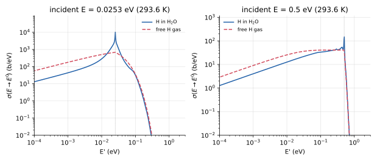
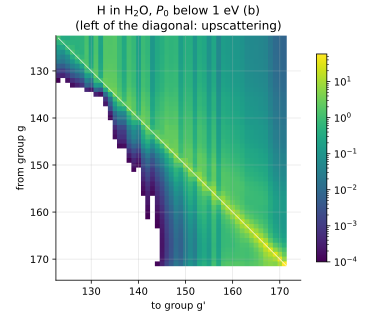

# Thermal scattering

Chapter 10 computed elastic scattering for a target **at rest**. That is
accurate down to a few eV, but in a thermal reactor most fissions are caused
by neutrons of a few hundredths of an eV, slower than the moderator's own
thermal motion. Three things then change:

* A neutron can **gain** energy in a collision (upscattering). The neutron
  population comes into equilibrium with the moderator rather than slowing
  down forever.
* The target atoms move, so the "elastic" kinematics of chapter 9 no longer
  fix $E'$ by the angle.
* In a molecule or a crystal the atom is **bound**: a slow neutron can
  excite rotations and vibrations of the whole molecule, and it scatters from
  an effectively heavier target.

This chapter describes the scattering law that captures all three, the
free-gas model that captures the first two, and how both become group
matrices with upscattering [[ENDF-102](#ref-endf102) §7;
[NJOY](#ref-njoy) ch. 7].

## The scattering law $S(\alpha, \beta)$

Van Hove's formulation splits the double-differential cross section into a
kinematic factor and a property of the material alone. Per atom, integrated
over the azimuth [[ENDF-102](#ref-endf102) eq. 7.6],

$$
\sigma(E \to E', \mu) = \frac{\sigma_b}{2kT}\sqrt{\frac{E'}{E}}\;e^{-\beta/2}\,S(\alpha, \beta),
$$

with the dimensionless energy and momentum transfers

$$
\beta = \frac{E' - E}{kT},
\qquad
\alpha = \frac{E + E' - 2\mu\sqrt{EE'}}{A\,kT},
$$

and the **bound-atom cross section** $\sigma_b = \sigma_{free}\,\left(\frac{A+1}{A}\right)^2$.
For hydrogen ($A \approx 1$) $\sigma_b = 81.8$ b, four times the free-atom
20.4 b: a neutron scattering from a hydrogen atom held by a heavy molecule
sees the bound value, and the free value only when the atom recoils freely.

$S(\alpha, \beta)$ is symmetric in $\beta$, so all the asymmetry between
energy gain and energy loss is in the factor $e^{-\beta/2}$. It gives
**detailed balance**: with $M(E) \propto E\,e^{-E/kT}$ the Maxwellian flux,

$$
M(E)\,\sigma(E \to E') = M(E')\,\sigma(E' \to E),
$$

so a Maxwellian population at the moderator temperature is left unchanged
by scattering. The code checks it to $10^{-15}$ for both models below.

## The free gas

For atoms that move freely with a Maxwellian distribution the scattering law
is known in closed form:

$$
S(\alpha, \beta)\,e^{-\beta/2} = \frac{1}{\sqrt{4\pi\alpha}}\,\exp\!\left[-\frac{(\alpha+\beta)^2}{4\alpha}\right].
$$

Integrated over $E'$ and $\mu$ it gives the free-gas cross section of a
constant $\sigma$, the formula of chapter 8 (section 8.4):
the code's kernel reproduces it to $10^{-4}$ or better for $A$ = 1, 16 and 236
from 0.01 to 4 eV. That closes a loop: chapter 8 broadened *cross sections*
with the same Maxwellian; here the same physics gives the *energy and angle
transfer* as well.

For every nuclide without a scattering law, the library uses the free-gas
kernel below 4 eV, normalized (as NJOY does) to the Doppler-broadened elastic
cross section of the pointwise table. Heavy nuclei change little: their
thermal motion barely affects a neutron, and the average lab cosine stays
close to $2/(3A)$ (O-16 at 0.0253 eV: 0.0407 against 0.0420). Hydrogen changes completely: at 0.0253 eV half of the
scattering in the XMAS thermal group (14.7 of 29.4 b) sends the neutron to a
*higher* group.

## Hydrogen in water

Water is not a free gas. ENDF/B-VIII.1 gives $S(\alpha, \beta)$ for H in
H$_2$O at 95 temperatures from 273 to 1000 K, on 317 values of $\beta$ and
222 of $\alpha$, computed from a model of the molecule's translations,
rotations and vibrations. Oxygen enters only through constants (a free gas
with $A = 15.86$). Two details of the format matter:

* With LAT = 1 the tabulated $\alpha$ and $\beta$ use $kT_0 = 0.0253$ eV;
  only the table lookup is rescaled, while the prefactor and $e^{-\beta/2}$
  use the actual temperature, as in NJOY's THERMR.
* Where $\alpha$ or $\beta$ leave the table (or the table runs out), the
  **short-collision-time** approximation takes over: a free-gas-like form
  with an effective temperature $T_{eff}$ (1194 K for water at 293.6 K),
  which accounts for the zero-point motion of the bound atom
  [[ENDF-102](#ref-endf102) eq. 7.8].

| E (eV) | H in H$_2$O (b/H) | free H gas (b) | $\bar\mu_{lab}$ in water |
| --- | --- | --- | --- |
| 0.0001 | 211.0 | 367.4 | −0.03 |
| 0.0253 | 51.7 | 30.1 | 0.18 |
| 0.1 | 32.5 | 23.0 | 0.34 |
| 1 | 21.5 | 20.7 | 0.57 |
| 4 | 20.6 | 20.5 | 0.64 |

At 0.0253 eV a water molecule scatters $2 \times 51.7 + 3.9 = 107$ b (the
oxygen as a free gas). The mean cosine is much smaller than the free-atom
$2/3$: a bound proton is effectively heavier, and scattering at thermal
energies is close to isotropic.

## Group matrices with upscattering

For each incident energy below the **thermal cutoff** of 4 eV (an XMAS-172
boundary; the water data reach 10 eV) the kernel
$K_l(E \to g')$ is integrated over $E'$ and $\mu$:

* in $E'$, by Gauss points on a grid that includes the group boundaries and
  points concentrated around $E$, up to $E + 40\,kT$;
* in $\mu$, through the variable $s = \sqrt\alpha$. At $E' \approx E$ the
  free-gas $S$ behaves like $1/\sqrt\alpha$ as $\alpha \to 0$; in $s$ the
  integrand is smooth:

$$
\int \mathrm{d}\mu\;\sigma(E\to E',\mu)\,P_l(\mu)
= \frac{\sigma_b A}{2E}\int \mathrm{d}s\; s\,e^{-\beta/2}S(s^2, \beta)\,P_l(\mu(s)).
$$

The kernel is tabulated every 0.02 in lethargy below 4 eV and averaged over
each source group with the Maxwellian weight, as in chapter 10. The library's
elastic matrix rows below 4 eV are replaced; for water, the group elastic
cross section and the total change with them. Group matrices obey detailed
balance, $\phi_g\,\sigma_{g\to g'} = \phi_{g'}\,\sigma_{g'\to g}$, to 0.1%
(the error falls quadratically with the kernel spacing: 9.6% at 0.2, 0.5% at
0.05, 0.02% at 0.01).

**What is not yet included.** UO$_2$ fuel has its own scattering laws (O and
U in UO$_2$, with coherent Bragg scattering); for these heavy atoms the free
gas is a common and adequate approximation. The libraries keep the
moderator temperature fixed per library; H in H$_2$O is available at the
file's temperatures only (ENDF-102 advises against interpolating $S$ in
temperature).

## Further reading

* [[ENDF-102](#ref-endf102)] §7 (the MF7 formats, the short-collision-time
  approximation) (free).
* [[NJOY](#ref-njoy)] ch. 7 (THERMR: free gas and $S(\alpha,\beta)$ kernels)
  and ch. 24 (LEAPR: how $S(\alpha,\beta)$ is computed from a model of the
  material) (free).
* [[Bell & Glasstone](#ref-bell)] ch. 7: neutron thermalization (free).
* Code: [`sab.py`](../../src/fission/endf/distributions/sab.py) (MF7
  reader), [`thermal.py`](../../src/fission/processing/thermal.py) (models,
  kernel, `with_thermal`). Libraries: `make groups` builds free-gas libraries
  for all nuclides and H in H$_2$O at 293.6, 600 and 900 K;
  `make library NUC=H1` shows one.
