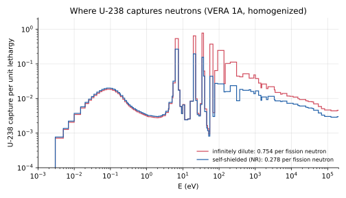
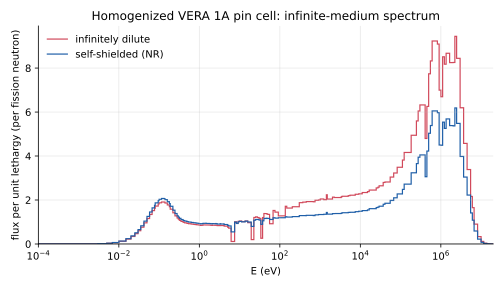

# The infinite medium: k∞ of a pin cell

This chapter puts the data of chapters 7–11 to their first real use. It
takes the pin cell of a pressurized-water reactor, smears its materials into
one homogeneous mixture, and computes the neutron spectrum and the
multiplication factor $k_\infty$ of an infinite sea of that mixture. No
geometry and no transport solver are needed yet, but every piece of the
nuclear data chain is exercised. One effect dominates the result, and the
chapter is about understanding it: **resonance self-shielding**.

## The pin cell: VERA Problem 1

The **VERA Core Physics Benchmark Progression Problems** specify a sequence
of PWR problems, from a single pin to a full core, with reference solutions
[[VERA](#ref-vera)]. Problem 1 is one Westinghouse 17×17 fuel rod in an
infinite lattice:

| Region | Outer radius (cm) | Material |
| --- | --- | --- |
| fuel | 0.4096 | UO$_2$, 3.1 wt% U-235, 10.257 g/cm³ |
| gap | 0.418 | helium |
| clad | 0.475 | Zircaloy-4 (Zr, with Sn, Fe, Cr, Hf) |
| moderator | square cell, pitch 1.26 | water with 1300 ppm boron |

with the states (fuel / moderator temperature, water density) 1A: 565 / 565 K,
0.743 g/cm³ (hot zero power); 1B: 600 / 600 K, 0.661 g/cm³; 1C and 1D: as
1B with fuel at 900 and 1200 K. The specification lists the number density
of every isotope in every region (its Table P1-4). This code uses those for
the gap and clad, and computes the fuel and water from their mass
densities, isotopics and boron content, agreeing with the table to its
printed precision (chapter 13). Homogenizing multiplies each by the region's share of the cell
area: the fuel occupies 33.2% of the cell, the water 55.4%. The same
nuclide in two regions (oxygen in fuel and water) stays two components,
because they have different temperatures and scattering laws.

Four isotopes of the cladding are left out: Fe-54 and Fe-57 use the
R-matrix-limited resonance format (LRF = 7), Fe-58 an unresolved-range form,
and Cr-53 a channel-spin convention that this code does not process yet.
Together they are 0.04% of the cladding atoms. (Chapter 6 later added
LRF = 7 and brought Fe-54 in. The numbers in this and the following chapters
were computed without it.) Everything else, 35
components from 34 nuclides, is processed from ENDF/B-VIII.1 at the
problem's temperatures, with S(α,β) for hydrogen in water. The geometry,
compositions and states are read from the model file of chapter 13.

## The infinite-medium equations

In an infinite homogeneous medium nothing depends on position or direction,
and every neutron born is eventually absorbed. The multigroup balance of
group $g$ is

$$
\Sigma_{t,g}\,\phi_g = \sum_{g'} \Sigma_{s,g'\to g}\,\phi_{g'}
+ \frac{1}{k_\infty}\sum_i \chi_{i,g}\sum_{g'} \nu\Sigma_{f,i,g'}\,\phi_{g'},
$$

where $i$ runs over the fissionable nuclides, each with its own fission
spectrum, and the transfer matrix includes the extra neutrons of $(n,2n)$.
In matrix form $(T - S^{\mathsf T})\,\phi = k^{-1} F\phi$, and $k_\infty$ is
the largest eigenvalue of $(T - S^{\mathsf T})^{-1}F$. With 172 groups the
Python reference computes it directly with a dense eigen-solve. The Rust
version uses the method the transport solver will need: **power
iteration**. It factors $T - S^{\mathsf T}$ once ($LU$ with partial
pivoting), then repeats $\phi \leftarrow (T - S^{\mathsf T})^{-1}F\phi/k$,
updating $k$ from the ratio of successive fission sources, until $k$
changes by less than $10^{-13}$; the two agree to $10^{-11}$. Summing the balance over all groups gives a check that the code
verifies: $k_\infty$ equals neutron production divided by net removal
(absorption, minus the extra neutrons from $(n,xn)$).

## Infinitely dilute libraries: $k_\infty = 0.74$

With the libraries of chapters 10 and 11 as they are, case 1A gives
$k_\infty = 0.743$, impossibly low for a fresh PWR core. The reason is
visible in the reaction rates: per fission neutron, U-238 absorbs 0.79
neutrons, more than U-235 (0.45). The dilute group cross sections assume a
smooth flux inside each group. Inside a large resonance, though, the flux
collapses: neutrons are removed there faster than they arrive. Chapter 8
showed the effect on the resonance integral of U-238: with a background
cross section of 100 b per U-238 atom, its capture resonance integral fell
from 274 to 22 b at room temperature. In the homogenized cell hydrogen and
oxygen alone give a background of about 90 b per U-238 atom.

The spectrum of the dilute calculation already shows the effect at the
level of whole groups: the groups containing the 6.67, 20.9 and 36.7 eV
resonances have a depressed group flux, because in an infinite medium a
group's flux varies like $1/\Sigma_{t,g}$. What is missing is the same dip
*inside* each group.

## Self-shielding in a homogeneous mixture

In an infinite homogeneous medium the dip has a simple description. If a
resonance is narrow compared with the energy a neutron loses in a collision
with the moderator, neutrons arrive at its energy with the smooth
slowing-down spectrum, and the flux at that energy is set by how quickly they
are removed again. This is the **narrow-resonance (NR) approximation**
[[Bell & Glasstone](#ref-bell) §8.3]:

$$
\phi(E) \approx \frac{w(E)}{\Sigma_t(E)},
$$

with $\Sigma_t(E)$ the pointwise total cross section of the whole mixture.
The code builds $\Sigma_t(E)$ on the union of all 34 pointwise grids (about
half a million points), and re-averages every library with the weight
$w(E)/\Sigma_t(E)$ instead of $w(E)$: cross sections, $\nu\sigma_f$, $\chi$,
and the scattering matrices, including the thermal ones. Because the
mixture's own resonances shape the weight, U-238's resonances shield U-235
and vice versa, and each nuclide's resonances shield themselves.

| Case | dilute | NR shielded | heterogeneous CE reference |
| --- | --- | --- | --- |
| 1A | 0.7431 | 1.14194 | 1.18704 ± 0.00005 |
| 1B | 0.7295 | 1.13693 | 1.18215 ± 0.00007 |
| 1C | 0.7291 | 1.12201 | 1.17172 ± 0.00007 |
| 1D | 0.7284 | 1.10930 | 1.16260 ± 0.00007 |

Self-shielding cuts U-238 capture from 0.754 to 0.278 per fission neutron
and raises $k_\infty$ by 0.40.

**Comparison with the reference.** The reference values are continuous-energy
Monte Carlo results (KENO-VI, ENDF/B-VII.0) for the *heterogeneous* pin cell,
and they are not the same problem. In the real cell the fuel is a lump: the
resonance neutrons are absorbed at the surface of the pellet, and its
interior sees a strongly depressed flux, so U-238 absorbs less than in the
homogeneous mixture. A homogenized $k_\infty$ is therefore expected to lie
below the heterogeneous one. Computing that difference is the job of the
transport solver and the spatial self-shielding steps that follow; checking
the homogeneous number itself needs an independent homogeneous calculation.

The **trends** are comparable, and they agree in sign and roughly in size:

| Change | this code (homogeneous, NR) | reference (heterogeneous) |
| --- | --- | --- |
| 1A → 1B: hotter, less dense water | −501 pcm | −489 pcm |
| 1B → 1C: fuel 600 → 900 K | −1492 pcm | −1043 pcm |
| 1C → 1D: fuel 900 → 1200 K | −1271 pcm | −912 pcm |

The fuel-temperature (Doppler) effect is negative and weakens with
temperature, as in the reference, and about 1.4 times larger, as expected
for a mixture in which U-238 resonance absorption matters more. With dilute
libraries the Doppler effect almost vanishes (−47 pcm for 1B → 1C): the dilute
resonance integral does not depend on temperature (chapter 8). The Doppler
coefficient exists *only* through self-shielding.

## The four factors

The classic way to read $k_\infty$ is as a product of four factors. Here
they are defined from the multigroup reaction rates, split at 0.625 eV, so
that the product equals $k_\infty$ exactly:

$$
k_\infty = \varepsilon\,p\,f\,\eta,
\qquad
\begin{aligned}
\varepsilon &= \frac{\text{all fission neutrons}}{\text{thermal fission neutrons}}, &
p &= \frac{\text{thermal removals}}{\text{all removals}},\\
f &= \frac{\text{thermal absorption in fuel}}{\text{all thermal removals}}, &
\eta &= \frac{\text{thermal fission neutrons}}{\text{thermal absorption in fuel}}.
\end{aligned}
$$

| 1A | $\varepsilon$ | $p$ | $f$ | $\eta$ | $k_\infty$ |
| --- | --- | --- | --- | --- | --- |
| dilute | 1.428 | 0.340 | 0.840 | 1.821 | 0.743 |
| NR shielded | 1.320 | 0.566 | 0.840 | 1.821 | 1.142 |

Self-shielding changes only $p$ (and $\varepsilon$, through the epithermal
fissions it counts): $f$ and $\eta$ are thermal quantities. These factors
split the energy range at 0.625 eV, so $\varepsilon$ includes fission of
U-235 in its resonances and is larger than the textbook "fast fission
factor", which counts fission above the U-238 threshold only; $p$ is
correspondingly smaller than the textbook resonance escape probability.

## What this calculation leaves out

* **Heterogeneity**, the largest effect: the separation of fuel and water.
* **Accuracy of the NR approximation.** It assumes resonances narrower than
  the collision energy loss. For the lowest U-238 resonances and the
  scattering of U-238 itself this is only approximate; intermediate-resonance
  methods and fine-group slowing-down calculations do better.
* **Data and processing differences** from the reference: ENDF/B-VIII.1
  against ENDF/B-VII.0, the omitted cladding isotopes, infinitely dilute
  treatment of the unresolved range, and S(α,β) for water taken at the
  case temperature (565 K is tabulated; the reference interpolated between
  550 and 600 K).

## Further reading

* [[VERA](#ref-vera)]: the benchmark specification, Problem 1 and its
  Appendix A (free).
* [[Bell & Glasstone](#ref-bell)] §8.3, the narrow-resonance approximation;
  [[Duderstadt & Hamilton](#ref-dh)] and [[Lamarsh](#ref-lamarsh)], the four-factor
  formula.
* Code: [`vera-p1.toml`](../../models/vera-p1.toml) (geometry, compositions,
  states and reference values; chapter 13), [`infinite.py`](../../src/fission/pincell/infinite.py)
  (mixture, eigenvalue, four factors), [`infinite.rs`](../../rust/src/infinite.rs)
  (LU and power iteration), [`run.py`](../../src/fission/pincell/run.py)
  (NR flux shape; `make pincell CASES=1A SHIELD=nr`).
