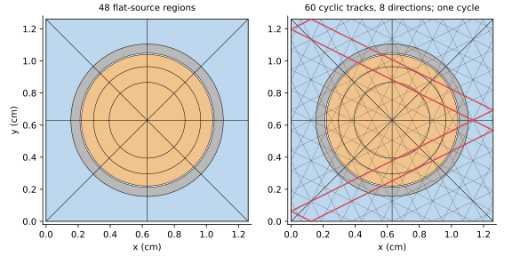

# Geometry and ray tracing

Chapter 12 removed space altogether. A real pin cell separates fuel, clad
and water, and the flux differs between them: at a strong U-238 resonance it
collapses inside the pellet and stays high in the water. Computing that
spatial shape is the job of a transport solver. This project's solver is
the **method of characteristics** (MOC). This chapter builds its geometric
foundation: the mesh of regions, the straight lines (tracks) along which MOC
integrates, and the segments into which the regions cut those lines. The
solver itself is the next step (B2).

## Why straight lines

In a medium with total cross section $\Sigma_t$ and a source $Q$ (scattering
plus fission, per unit solid angle), the angular flux $\psi$ of neutrons
moving in direction $\boldsymbol\Omega$ changes along their flight path $s$ as

$$
\frac{\mathrm{d}\psi}{\mathrm{d}s} + \Sigma_t\,\psi = Q .
$$

Along a straight line, the **characteristic**, this is an ordinary
differential equation. If $\Sigma_t$ and $Q$ are constant over a piece of the
line of length $\ell$, the solution is

$$
\psi_{\text{out}} = \psi_{\text{in}}\,e^{-\Sigma_t \ell}
+ \frac{Q}{\Sigma_t}\left(1 - e^{-\Sigma_t \ell}\right).
$$

MOC therefore divides the geometry into **flat-source regions** (FSRs), in
which $Q$ is assumed constant. It covers them with many parallel lines in many
directions, and applies this formula segment by segment
[[OpenMOC](#ref-openmoc)]. Averaging $\psi$ along the segments that cross a
region gives that region's scalar flux. Everything the solver needs from the
geometry is therefore a list of **segments**: (region, length) for every
line. This chapter computes that list.

## Flat-source regions

A lattice is a grid of square cells of one pitch. Each cell is a pin:
concentric rings, with the last material filling the square. Each ring can
be split further:

* **Rings.** A material ring between radii $r_{\text{in}}$ and
  $r_{\text{out}}$ can be divided into $n$ rings of equal area, with radii
  $r_k^2 = r_{\text{in}}^2 + \frac{k}{n}(r_{\text{out}}^2 -
  r_{\text{in}}^2)$. The fuel needs this most, because the resonance flux
  dips towards its centre.
* **Sectors.** $n_s$ rays from the cell centre, at angles
  $2\pi k/n_s$, cut every ring. This gives the water in the corners of the
  cell, far from the pin, regions of its own.

The exact area of every region is known. An annulus sector has
$\pi(r_k^2 - r_{k-1}^2)/n_s$. The water outside the last circle is a wedge
of the square, computed as a polygon with the shoelace formula, minus a
wedge of the disc. With 3 fuel rings and 8 sectors, the VERA cell has 48
regions (left panel below).

## Cyclic tracks

For each azimuthal angle $\varphi$, parallel tracks a distance $\delta$ apart
cross the $W\times H$ rectangle. A track represents the strip of width
$\delta$ around it, so the area of region $i$ is estimated by

$$
A_i \approx \sum_{\text{tracks}} \delta\,\ell_{i},
$$

with $\ell_i$ the length of the track inside region $i$. Areas, and later
fluxes, are therefore quadratures over the tracks.

**Reflective boundaries.** A pin cell in an infinite lattice is modelled
with reflective sides: a neutron leaving through one side comes back with
its direction mirrored. In MOC the flux leaving a track must then be
handed to the track with the mirrored direction that starts at the same
point. This works without interpolation only if the tracks of $\varphi$ and
of $\pi-\varphi$ meet every side at the same points. With $n_x$ tracks
entering through the bottom side and $n_y$ through the left side, evenly
spaced, this requires

$$
\tan\varphi = \frac{H/n_y}{W/n_x}
\quad\Rightarrow\quad
\varphi = \arctan\frac{H\,n_x}{W\,n_y},
\qquad
\delta = \frac{W}{n_x}\sin\varphi = \frac{H}{n_y}\cos\varphi .
$$

So neither the angle nor the spacing can be chosen exactly. The code
spreads the requested angles evenly over the first quadrant. For each one
it takes $n_x = \lfloor W\sin\varphi/\delta\rfloor + 1$ and
$n_y = \lfloor H\cos\varphi/\delta\rfloor + 1$, then recomputes $\varphi$
and $\delta$ from those counts [[OpenMOC docs](#ref-openmocdocs) §5.1].

For the VERA cell with 64 directions and 0.01 cm requested:

| requested angle | adjusted angle | $n_x$ | $n_y$ | spacing |
| --- | --- | --- | --- | --- |
| 2.81° | 3.18° | 7 | 126 | 0.00998 cm |
| 8.44° | 8.64° | 19 | 125 | 0.00997 cm |
| 14.06° | 14.15° | 31 | 123 | 0.00993 cm |

Following the reflections, a sweep along any track returns to its start:
the tracks are **cyclic**. For this tracking the cycles are 38 to 358 sweeps
long. Every track is swept in both directions, so the angles are kept in
$(0,\pi)$; the backward sweeps cover $(\pi, 2\pi)$. Each sweep's exit is
linked to the sweep that continues it. On a **vacuum** side (used for the
outer boundary of benchmarks such as C5G7) the link is empty and the
outgoing flux is lost as leakage.

**Azimuthal weights.** Angle $\varphi_a$ stands for the arc between the
midpoints of its neighbours, with 0 and $\pi/2$ at the ends of the
quadrant. Its weight is that arc as a fraction of $\pi$, and the mirror
angle $\pi - \varphi_a$ gets the same weight.

These tracks are two-dimensional. A real neutron also moves out of the
plane, at a polar angle $\theta$, and travels $\ell/\sin\theta$ along a 2D
segment of length $\ell$. That is handled by a polar quadrature in the
solver (B2); the segments do not change.

## Ray tracing

Along a track $\mathbf p(t) = \mathbf p_0 + t\,\mathbf d$, with
$|\mathbf d| = 1$, the region changes only where the track crosses a
surface:

* the **grid lines** between cells: $t = (i p - x_0)/d_x$, and likewise for
  $y$;
* the **circles**, $|\mathbf p(t) - \mathbf c| = r$: with
  $b = \mathbf d\cdot(\mathbf p_0 - \mathbf c)$ and
  $q = |\mathbf p_0 - \mathbf c|^2 - r^2$, the crossings are
  $t = -b \pm\sqrt{b^2 - q}$ when $b^2 > q$;
* the **sector lines** through $\mathbf c$ in direction $\mathbf u$:
  $t = [(\mathbf c - \mathbf p_0)\times\mathbf u]/(\mathbf d\times\mathbf u)$.

The code collects all crossings, sorts them, and finds the region that
contains the midpoint of each piece. This is slower than stepping from one
surface to the next, but it cannot lose its way at a corner or a tangent.
Pieces shorter than $10^{-10}$ cm are dropped, and adjacent pieces in the
same region are merged.

## Checks

* **Each angle tiles the rectangle exactly.** For every angle,
  $\sum \delta \ell$ over all its tracks equals $W H$ to rounding.
* **Region areas converge.** The weighted track estimate approaches the
  exact area as the spacing shrinks. VERA cell, 64 directions, largest
  relative error over each material's regions:

| spacing (cm) | tracks | segments | fuel | gap | water |
| --- | --- | --- | --- | --- | --- |
| 0.05 | 1,056 | 8,384 | 7.7e-3 | 3.6e-2 | 1.0e-3 |
| 0.01 | 5,168 | 41,712 | 8.6e-4 | 4.4e-3 | 2.0e-4 |
| 0.002 | 25,720 | 207,776 | 4.0e-5 | 7.9e-4 | 2.0e-5 |
| 0.001 | 51,392 | 415,328 | 2.5e-5 | 3.6e-5 | 7.5e-7 |

  The gap is 0.0084 cm thick, so few tracks cross it until the spacing is
  comparable. A single angle alone is much worse (6% at 0.01 cm, 0.5% at
  0.001 cm): a thin ring is crossed by few tracks, whose positions happen to
  favour or miss it, and these errors partly cancel between angles. MOC codes usually correct the remaining error by
  rescaling the segment lengths of each region so that the track areas match
  the exact ones. The solver will do the same.
* **Links.** At every link, the next sweep starts at the point where the
  last one left, with the direction mirrored. Every sweep is entered from
  exactly one other, so the links form a permutation, and its cycles close.
* **Rust.** The ray tracer is ported to Rust (`raytrace.rs`, threaded over
  tracks) with the same operations in the same order. Its segments are
  identical to the Python ones, bit for bit. For a 17×17 lattice of VERA
  pins at 0.05 cm with 64 directions (17,500 tracks, 2.4 million
  segments), Python would need about 4 s and Rust takes 0.03 s.

## Further reading

* [[OpenMOC](#ref-openmoc)], [[OpenMOC docs](#ref-openmocdocs)] (free):
  cyclic track generation, azimuthal weights, and the MOC equations in the
  same notation.
* [[Hébert](#ref-hebert)] (not free): tracking and the method of
  characteristics in lattice codes.
* Code: [`geometry.py`](../../src/fission/transport/geometry.py) (regions and
  exact areas), [`tracks.py`](../../src/fission/transport/tracks.py) (cyclic
  tracks, weights, links), [`trace.py`](../../src/fission/transport/trace.py)
  (segments, track areas), [`raytrace.rs`](../../rust/src/raytrace.rs).
