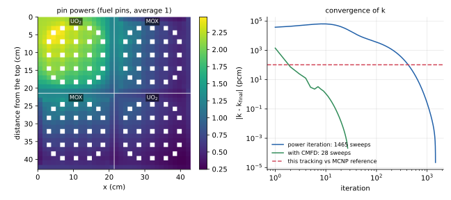

# The method of characteristics

Chapter 14 divided the geometry into flat-source regions and covered it with
cyclic tracks. This chapter solves the multigroup transport equation on them,
for the multiplication factor $k$ and the flux in every region. It then checks
the solver on the standard benchmark for this kind of code, C5G7.

## The transport equation along a track

For energy group $g$, the angular flux $\psi_g$ along a straight flight path
obeys

$$
\frac{\mathrm{d}\psi_g}{\mathrm{d}s} + \Sigma_{t,g}\,\psi_g = Q_g ,
\qquad
Q_{i,g} = \frac{1}{4\pi}\Big[\sum_{g'} \Sigma_{s,g'\to g}\,\phi_{i,g'}
+ \frac{\chi_{i,g}}{k}\sum_{g'}\nu\Sigma_{f,i,g'}\,\phi_{i,g'}\Big].
$$

Scattering is taken as **isotropic**, and $Q_{i,g}$ is constant in each flat-source
region $i$. Anisotropic scattering is approximated with the **transport
correction**: the total cross section is replaced by the transport cross
section $\Sigma_{tr} = \Sigma_t - \bar\mu\,\Sigma_s$, which keeps the
diffusion length right [[Bell & Glasstone](#ref-bell)]. The C5G7 data
are given this way.

A 2D track carries neutrons moving at every **polar angle** $\theta$ (measured
from the axial direction $z$). Such a neutron travels $\ell/\sin\theta$ while
crossing a segment of 2D length $\ell$. With
$\tau = \Sigma_{t,g}\,\ell/\sin\theta$, the solution of chapter 14 gives the
change of angular flux over one segment:

$$
\Delta\psi = \Big(\psi_{\text{in}} - \frac{Q}{\Sigma_t}\Big)\left(1 - e^{-\tau}\right),
\qquad
\psi_{\text{out}} = \psi_{\text{in}} - \Delta\psi .
$$

$1 - e^{-\tau}$ is computed as $-\mathrm{expm1}(-\tau)$, which stays accurate
for the very thin segments that tracks cut near corners.

## From segments to region fluxes (derivation)

Integrate the transport equation over one segment. The neutrons that leave
it, minus those that enter, equal the source inside minus the collisions:
$\psi_{\text{out}} - \psi_{\text{in}} = \frac{\ell}{\sin\theta}\,Q -
\Sigma_t\int\psi\,\mathrm d s$. So the integral of $\psi$ along the segment's
3D path is $\big(\frac{\ell}{\sin\theta}Q + \Delta\psi\big)/\Sigma_t$.
Measured along the 2D track, multiply by $\sin\theta$:

$$
\int_{\text{segment}} \psi \,\mathrm d s_{2D}
= \frac{\ell\,Q + \sin\theta\,\Delta\psi}{\Sigma_t}.
$$

A track stands for a strip of width $\delta$. Summing $\delta\times$ this
integral over all segments in region $i$ integrates $\psi$ over the region's
area. Since $\sum\delta\,\ell = A_i$ (chapter 14), the average angular flux
in direction $(\varphi, \theta)$ is

$$
\bar\psi_i = \frac{Q_i}{\Sigma_{t,i}}
+ \frac{1}{\Sigma_{t,i} A_i}\sum_{\text{segments in } i}\delta\,\sin\theta\,\Delta\psi .
$$

The scalar flux integrates over all directions, $\phi = \int_{4\pi}\psi\,\mathrm
d\Omega$. In 2D the flux is symmetric above and below the plane, so the
polar angles on $(0, \pi/2)$ are counted twice. Each track is swept both ways,
which covers the azimuths in $(0,\pi)$ and $(\pi, 2\pi)$. With azimuthal
weights $w_a$ (summing to 1 over $(0,\pi)$, chapter 14) and polar weights
$\omega_p$ (summing to 1 over $(0,\pi/2)$), each sweep direction carries the
solid angle $2\pi\,w_a\,\omega_p$, and all directions together add up to
$4\pi$. Therefore

$$
\phi_{i,g} = \frac{4\pi\,Q_{i,g}}{\Sigma_{t,i,g}}
+ \frac{1}{\Sigma_{t,i,g}\,A_i}\sum_{\text{segments in } i} W\,\Delta\psi_g ,
\qquad
W = 2\pi\,w_a\,\omega_p\,\delta_a\,\sin\theta_p .
$$

The first term is the flux of an infinite medium with that source. The
second term corrects it with what the tracks see: neutrons streaming in
from elsewhere, or escaping.

**Polar quadrature.** This code uses Gauss–Legendre points in
$\mu = \cos\theta$ on $(0, 1)$. Production MOC codes often use the
Tabuchi–Yamamoto set, which is optimized for the integrals that appear here
and is more accurate with two or three angles. Gauss–Legendre is easy to
derive and converges as the number of angles grows.

**Boundaries.** A sweep's outgoing flux becomes, in the next iteration, the
incoming flux of the sweep it is linked to (reflective sides). At a vacuum
side it is counted as **leakage**, $\sum W\,\psi_{\text{out}}$.

**Area correction.** Before solving, every segment length in region $i$ is
multiplied by $A_i/\tilde A_i$, with $\tilde A_i$ the area estimated from the
tracks (chapter 14). This makes the weighted track areas exact.

## Power iteration

$k$ is the largest eigenvalue of the transport problem. The solver uses
**power iteration** with a single transport sweep per iteration:

1. From the current $\phi$ and $k$, form the source $Q$ (scattering plus
   fission over $k$).
2. Sweep every track in both directions, and form the new $\phi$.
3. Update $k \leftarrow k\cdot\sum_i A_i\,\nu\Sigma_f\phi^{\text{new}} /
   \sum_i A_i\,\nu\Sigma_f\phi^{\text{old}}$.

At convergence, neutron production divided by (absorption + leakage) equals
$k$; the tests check this. "Absorption" here must be
$\Sigma_t - \sum_{g'}\Sigma_{s,g\to g'}$, the removal the transport equation
actually uses. The benchmark's tabulated absorption agrees with it only to
the six printed digits.

**Slow convergence.** One sweep moves angular flux one track length across
the geometry. In regions that are thin and scatter strongly, the incoming
fluxes approach their final values only slowly. Successive changes shrink
by a nearly constant ratio $\rho$, close to 1 (0.995 per iteration in the
one-material test). A small change per iteration therefore does not mean
convergence: after a change $d$, the remaining error is
$d(\rho + \rho^2 + \dots) = d\,\rho/(1-\rho)$. The solver measures $\rho$ over
the last 10 iterations and stops when this *estimated remaining error* of
$k$ and of the fission source is below the tolerance. The cure for the
slowness is acceleration: a coarse-mesh problem that moves neutrons across
the whole core at once (CMFD, below).

**Rust.** The sweep is the hot loop. Its Rust port (`moc.rs`) splits the
tracks over threads: within one sweep, tracks are independent, because their
incoming fluxes come from the previous iteration. Each thread keeps its own
tally, and the tallies are added at the end. The iteration around it stays in
Python. On a pin cell, Python and Rust agree to $10^{-15}$ in $k$; one C5G7
sweep (5.9 million segments, 7 groups, 3 polar angles) takes 0.17 s.

## Acceleration: coarse-mesh finite difference (CMFD)

Power iteration is slow because each sweep carries information one track
length further. CMFD adds, after every sweep, a small problem on a coarse
mesh, here one cell per pin cell, that couples the whole core at once and is
cheap to solve completely. Its answer then rescales the MOC fluxes.

**The coarse balance is exact.** Integrate the transport equation over a
coarse cell $c$ of area $V_c$ and over all directions:

$$
\sum_{\text{faces}} J_{\text{out}} + \Sigma_{t,c,g}V_c\,\phi_{c,g}
= V_c\Big[\sum_{g'}\Sigma_{s,g'\to g,c}\,\phi_{c,g'}
+ \frac{\chi_{c,g}}{k}\sum_{g'}\nu\Sigma_{f,c,g'}\,\phi_{c,g'}\Big].
$$

The coarse cross sections are flux-volume weighted,
$\Sigma_{x,c} = \sum_i A_i\Sigma_{x,i}\phi_i / \sum_i A_i\phi_i$, and the
$J$ are the **net currents** through the cell faces. The sweep tallies them:
where a track crosses a face, it adds $\sum_p W\psi$ with the sign of its
direction, the same flow measure as the leakage. For the region sums of
the sweep, $\sum W\Delta\psi$ over a cell telescopes to the inflow minus
the outflow through its faces. The tests check this identity cell by cell.

**Closing it with diffusion.** To solve for new fluxes, the currents must be
written in terms of the coarse fluxes. Finite-difference diffusion, with
$D = 1/(3\Sigma_t)$ and a correction term $\hat D$, gives across the face
between cells L and R

$$
J = -\tilde D\,(\phi_R - \phi_L) - \hat D\,(\phi_R + \phi_L),
\qquad
\tilde D = \frac{2D_LD_R}{D_L + D_R},
$$

with $\phi = 0$ outside the core. On a uniform mesh the face length and the
cell width cancel. A vacuum side uses the Marshak condition,
$\tilde D = 2Dh/(h + 4D)$; a reflective side has no current. The
correction $\hat D$ is chosen so that the formula returns *exactly the MOC
current* at the present fluxes:

$$
\hat D = -\frac{J_{\text{MOC}} + \tilde D(\phi_R - \phi_L)}{\phi_R + \phi_L}.
$$

The coarse problem therefore has the MOC solution as its own solution
once MOC has converged. Diffusion theory only shapes how the iteration
gets there, so it introduces no diffusion error. The tests check that, at
the converged MOC flux, every coarse equation balances to $10^{-8}$.

**Solving it.** The coarse problem has 51 × 51 cells × 7 groups for C5G7. It is
solved by its own power iteration on $k$. Each outer iteration sweeps the
groups from fast to thermal, so down-scattered neutrons are used at once
(Gauss–Seidel in energy). Each group's five-point system gets four passes
of red–black successive over-relaxation (factor 1.5). This takes a few
hundred cheap outer iterations, about 0.02 s in Rust.

**Prolongation.** Every MOC flux in coarse cell $c$ is multiplied by
$\phi_c^{\text{new}}/\phi_c^{\text{MOC}}$. So is the incoming angular flux
of every track that starts in $c$. $k$ is taken from the coarse problem.

**Stability.** Plain CMFD diverged on C5G7: after a dozen iterations the
correction factors swung between 0.02 and 37, and then went negative. The
trouble starts in the reflector corner next to the vacuum sides, in the
thermal group, where a water cell is $\Sigma_t h \approx 3.3$ mean free
paths thick. CMFD is known to become unstable on optically thick coarse
cells. Several cures exist: optimally diffusive CMFD and partial-current
CMFD change the coarse equations. This code uses the simplest one,
**under-relaxing the correction**,
$\hat D \leftarrow w\hat D + (1 - w)\hat D^{\text{previous}}$. With $w = 0.7$
or $0.5$, C5G7 converged in about 20 iterations; $w = 0.3$ also converged, a
little more slowly. The choice is empirical, tested on these problems; it
is not a proven bound.

## Checks

* **One material everywhere.** If all regions hold the same material, the
  flat flux is exact whatever the tracking. MOC must then return the
  infinite-medium $k_\infty$ of that material (chapter 12). It does, to
  $10^{-9}$, with the flux flat to $10^{-9}$.
* **Neutron balance**, with reflective and with vacuum sides: production
  over absorption plus leakage equals $k$ to $10^{-7}$.
* **Discretization.** Refining the tracks (8→64 directions, 0.1→0.01 cm)
  converges $k$ of a pin cell.
* **CMFD** returns the same $k$ (to $10^{-8}$) and flux shape (to
  $10^{-6}$) as plain power iteration, with reflective and with vacuum
  sides, in a quarter of the iterations or fewer. Python and Rust agree on
  the currents to $10^{-12}$, and on the coarse solve to $10^{-13}$.

## C5G7

The C5G7 benchmark [[C5G7](#ref-c5g7)] is a quarter of a small PWR core:

* two UO$_2$ and two MOX assemblies of 17×17 pins, surrounded by water;
* reflective sides on the top and left, vacuum on the bottom and right;
* seven-group, transport-corrected cross sections for seven materials:
  UO$_2$, three MOX enrichments, guide tube, fission chamber and moderator.

The pins are cylinders of radius 0.54 cm, with no separate clad: fuel and
clad are mixed into one material, so there is no fuel-coolant
homogenization. The reference is a multigroup Monte Carlo (MCNP) solution
with the same cross sections: $k = 1.18655$, to 0.003%. Any difference is
therefore an error of the deterministic method, not of the data.

The model file `models/c5g7.toml` holds the cross sections (Table 1 of the
specification, extracted from its text by script) and the layout. The
assembly maps were read from the specification's Figure 3 by classifying
the grey level of each cell. They match the stated counts: 24 guide tubes
and one fission chamber per assembly, and MOX zones of 64, 100 and 100
pins.

**Acceleration.** Without CMFD, every run needed about 1240 sweeps,
whatever the tracking. With CMFD it needs 22–39, and gives the same $k$:

| tracking | regions | without CMFD | with CMFD | $k$ |
| --- | --- | --- | --- | --- |
| 16 directions, 0.1 cm, 2 polar, 1 ring, 4 sectors | 15,028 | 1241 sweeps, 82 s | 22, 1.7 s | 1.185433 |
| 32 directions, 0.05 cm, 3 polar, 2 rings, 8 sectors | 39,304 | 1242 sweeps, 314 s | 33, 8 s | 1.186933 |

Both runs are converged to an estimated error below $10^{-6}$ in $k$ and
$10^{-5}$ in the fission source.

**Where the error was.** With the solver now cheap, the discretization can
be studied. All of the following runs use CMFD and are converged to
$10^{-7}$ in $k$:

| directions, spacing, polar | fuel rings | sectors | coolant mesh | regions | $k$ vs MCNP |
| --- | --- | --- | --- | --- | --- |
| 16, 0.1 cm, 2 | 1 | 4 | none | 15,028 | −112 pcm |
| 32, 0.05 cm, 3 | 2 | 8 | none | 39,304 | +38 pcm |
| 32, 0.05 cm, 6 | 2 | 8 | none | 39,304 | +43 pcm |
| 64, 0.03 cm, 3 | 3 | 8 | none | 48,552 | +65 pcm |
| 128, 0.02 cm, 3 | 3 | 8 | ring in reflector cells | 71,672 | +66 pcm |
| 64, 0.03 cm, 3 | 3 | 8 | ring at 0.6 cm everywhere | 80,920 | +17 pcm |
| 64, 0.03 cm, 3 | 3 | 16 | ring at 0.6 cm everywhere | 161,840 | **−2 pcm** |
| 128, 0.02 cm, 4 | 3 | 16 | ring at 0.6 cm everywhere | 161,840 | +10 pcm |

More directions, more polar angles and finer spacing *raised* $k$ and then
stopped changing it, near +65 pcm. So the angular error had been partly
cancelling an error of the opposite sign. That error was the flat-source
approximation in the **coolant**: each pin cell's water outside the pin was
one region per sector, although its flux changes strongly between the pin
surface and the cell corner. An extra ring at 0.6 cm (inside the 0.63 cm
half pitch) and 16 sectors give the coolant a mesh fine enough for flat
sources. These rings change only the mesh, not the geometry (the
`outer_ring` option). The benchmark's own participants differ from the
reference by 0.1 to about 950 pcm [[C5G7](#ref-c5g7), Table 17]; among
the characteristics codes, DeCART is at +4 pcm and APOLLO2 at −31 pcm.

The default of `make moc` uses this mesh, with 64 directions, 0.03 cm
spacing, 3 polar angles, 3 fuel rings and 138,720 regions (the reflector
cells hold no pin, so they get the ring but no pin rings). It runs in
44 s:

| | reference (MCNP) | this code |
| --- | --- | --- |
| $k$ | 1.186550 | 1.186560 (+1 pcm) |
| inner UO$_2$ assembly power | 492.8 | 492.5 (−0.06%) |
| MOX assembly power | 211.7 | 211.7 (+0.02%) |
| outer UO$_2$ assembly power | 139.8 | 140.1 (+0.18%) |
| maximum pin power | 2.498 | 2.497 (−0.04%) |

The pin powers are normalized to an average of 1 over the 1056 fuel pins,
and an assembly's power is the sum over its 264 pins. The reference's own
uncertainties are 0.003% for $k$ and 0.1–0.2% for the assembly powers
(Tables 3–5).

## Further reading

* [[C5G7](#ref-c5g7)] (free): the specification (Chapter 2, Appendix A) and
  the results of the participating codes.
* [[OpenMOC](#ref-openmoc)], [[OpenMOC docs](#ref-openmocdocs)] (free):
  the same equations, the Tabuchi–Yamamoto quadrature, and CMFD.
* [[Hébert](#ref-hebert)] (not free): the method of characteristics and its
  acceleration.
* Code: [`moc.py`](../../src/fission/transport/moc.py) (sweep, power
  iteration, convergence estimate), [`moc.rs`](../../rust/src/moc.rs),
  [`cmfd.py`](../../src/fission/transport/cmfd.py) and
  [`cmfd.rs`](../../rust/src/cmfd.rs) (coarse mesh, corrections, coarse
  solve), [`trace.py`](../../src/fission/transport/trace.py) (face crossings),
  [`run.py`](../../src/fission/transport/run.py) (C5G7 driver and reference
  values), [`c5g7.toml`](../../models/c5g7.toml),
  [`c5g7-xs.toml`](../../models/c5g7-xs.toml); `make moc`.
