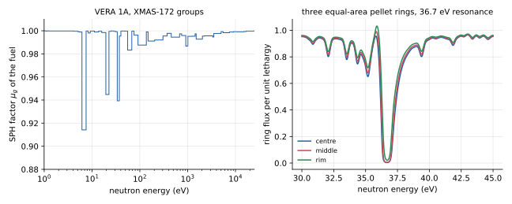

# A continuous-energy reference

Chapter 16 ended 713 pcm below the KENO reference of VERA problem 1A, with
no way to tell how much of that is nuclear data (KENO used ENDF/B-VII.0)
and how much is method. This chapter answers the question with an
independent calculation on the *same* data. The comparison then points to
two method errors, and the chapter corrects both:

* **superhomogenization** (SPH), which makes the multigroup flux of the
  shielded groups consistent with the pointwise one;
* **spatially dependent shielding**: rings in the pellet, each with its own
  flux shape and its own slowing-down source.

## Same data, different method

[OpenMC](#ref-openmc) is a continuous-energy Monte Carlo code. It follows
individual neutrons through the exact geometry with pointwise cross
sections, so it makes none of this code's approximations: no energy
groups, no flat sources, no escape probabilities, no transport correction.
It reads HDF5 libraries made by NJOY. `checks/openmc_library.py` makes them
from the same ENDF/B-VIII.1 files that this code reads, in the following
order:

1. reconstruction (RECONR);
2. Doppler broadening at 565, 600, 900 and 1200 K (BROADR);
3. probability tables in the unresolved range (PURR, see below);
4. ACE files.

H in H₂O is processed at 565 and 600 K, two of the file's tabulated
temperatures, as here.

So the two codes share only the evaluations. Every processing step is
independent: reconstruction, broadening and thermal scattering are NJOY's,
and transport is Monte Carlo. OpenMC and NJOY live in a separate
environment (`make tools`) and never feed the pipeline. The exchange goes
through files:

* `fission.pincell.reference` writes the pin as JSON: radii, number
  densities (without the nuclides this code cannot read yet, so that both
  codes see the same materials), temperatures and S(α,β).
* `checks/openmc_pin.py` runs OpenMC.
* `fission.pincell.reference` reads back k and reaction rates in the
  XMAS-172 groups, by nuclide and by fuel ring.

`make openmc-pin STATES=1A` runs the whole chain. With 2×10⁵ neutrons per
batch and 200 active batches, each state takes about 15 minutes on 16 cores,
and k is known to ±15 pcm.

| state | KENO (VII.0) | OpenMC (VIII.1) | OpenMC − KENO | chapter 16 − OpenMC |
| --- | --- | --- | --- | --- |
| 1A | 1.18704 | 1.18680 ± 0.00014 | −24 pcm | −689 pcm |
| 1B | 1.18215 | 1.18162 ± 0.00015 | −53 pcm | −701 pcm |
| 1C | 1.17172 | 1.17155 ± 0.00015 | −17 pcm | −844 pcm |
| 1D | 1.16260 | 1.16329 ± 0.00015 | +69 pcm | −996 pcm |

**The data are not the problem.** ENDF/B-VIII.1 and VII.0 give the same
pin within 70 pcm. Almost all of chapter 16's offset is method.

### Where the method loses neutrons

The reaction rates locate the error precisely. Per fission neutron
produced, chapter 16's "sd" calculation agrees with OpenMC for every
nuclide and energy band except one: **U-238 capture between 1 eV and
24.8 keV**, 0.2377 against 0.2324 (+2.3%). That excess alone accounts for
the whole k offset.

By group, the excess sits in the groups of the large U-238 resonances:

| group | contains | chapter 16 vs OpenMC |
| --- | --- | --- |
| 6.16–7.52 eV | 6.67 eV | +3.6% |
| 19.5–22.6 eV | 20.9 eV | +5.7% |
| 33.7–37.3 eV | 36.7 eV | +8.7% |
| 55.6–67.9 eV | 66.0 eV | +4.7% |
| 204–304 eV | 208 eV | +5.2% |

That is the signature of an error in how the shielded groups are used, not
in how they are made.

## Superhomogenization

Chapter 16 makes the group cross sections by flux weighting:

$$
\Sigma_g = \frac{\langle \Sigma\,\phi \rangle_g}{\langle \phi \rangle_g}.
$$

This preserves the reaction rate $\langle\Sigma\phi\rangle_g$ only if the
multigroup transport calculation then reproduces the group flux
$\langle\phi\rangle_g$. **It does not.** In the self-shielding model the
fuel flux is a non-linear function of the cross section,

$$
\phi(E) = P\big(\Sigma_t(E)\big)\,\psi_M + \big(1 - P(\Sigma_t(E))\big)\,\frac{S}{\Sigma_t(E)}.
$$

The same model with a constant $\Sigma_g$ across the group gives a flux of
its own, $\phi^{MG}_g = P(\Sigma_g)\langle\psi_M\rangle +
(1-P(\Sigma_g))\langle S\rangle/\Sigma_g$, and the two differ: an average of
a non-linear function is not the function of the average.

In a large resonance, the flux-weighted $\Sigma_g$ is dominated by the
wings where the flux is high. To the multigroup calculation the fuel looks
more transparent than it is, so its flux comes out too high, and so does
its capture.

**SPH factors** [[Hébert](#ref-hebert)] fix this by multiplying every cross
section of region $k$ in group $g$ by a factor $\mu_{k,g}$. The factor is
chosen so that the multigroup version of the self-shielding model
reproduces the reference rates:

$$
\mu_{k,g}\;\phi^{MG}_{k,g}(\mu) = \langle \phi_k \rangle_g .
$$

The multigroup flux is then $\langle\phi_k\rangle_g/\mu_{k,g}$, and every
rate $\mu\Sigma_g\cdot\langle\phi\rangle_g/\mu =
\Sigma_g\langle\phi\rangle_g$ is preserved.

Each $\phi^{MG}$ comes from the same one-group fixed-source MOC problem
that defines $P$ (chapter 16), solved once per group:

* the resonant regions have cross section $\mu_{k,g}\Sigma_{k,g}$ and the
  group-averaged source $\langle S_k\rangle_g$;
* every other region is a pure absorber $\Sigma_p$ with source
  $\Sigma_p\langle\psi_M\rangle_g$.

The usual fixed-point iteration, $\mu \leftarrow \langle\phi\rangle/\phi^{MG}(\mu)$,
converges in a few steps. With a single fuel region it reduces to a scalar
equation on the $P(\Sigma)$ table. A test checks that the two forms agree
and that SPH leaves groups without structure alone ($\mu = 1$).

The factors are close to 1 except in the big U-238 resonances: 0.911 for the
6.67 eV group and 0.94 for 20.9 eV and 36.7 eV. These are the groups
OpenMC flagged, by similar amounts. For the clad, every $\mu_g$ is within
4×10⁻⁴ of 1. With SPH, the "sd" calculation of 1A moves **from −689 to −245
pcm**, and the 6.67 eV group agrees with OpenMC to 0.2%.

## Rings in the pellet

The remaining excess is in resonances with large neutron widths (20.9,
36.7, 66, 102 and 208 eV), where a neutron is often scattered by U-238
before it is captured. The flux inside the pellet is not uniform there.
Neutrons arrive from the moderator, so the rim sees more of them than the
centre, and the rim absorbs more per atom. Lattice codes therefore split
the pellet into rings, each with its own shielded cross sections.

**Escape from each ring.** Let $E_k(\Sigma)$ be the probability that a
neutron born in ring $k$ makes its first collision outside the fuel.
Reciprocity gives all rings from one sweep per $\Sigma$ (`ring_escape`):
$V_j\Sigma_jP_{j\to k} = V_k\Sigma_kP_{k\to j}$. It holds because both
sides are the same double integral of
$\Sigma_j\Sigma_k\,e^{-\tau(\mathbf r,\mathbf r')}/(4\pi|\mathbf r-\mathbf r'|^2)$
over the two regions, and the optical path $\tau$ between two points is the
same in both directions. Put a source $\Sigma_j$ per unit volume in every region
outside the fuel. Then the collision rate in ring $k$ is
$\sum_j V_j\Sigma_jP_{j\to k} = \Sigma V_kE_k$. The volume average of the
$E_k$ is chapter 16's $P$.

**A flat source is not enough.** If the in-pellet scattering source $S$ is
the same in every ring, the same reciprocity argument gives
$\phi_k = E_k\psi_M + (1-E_k)S/\Sigma_t$. At 6.67 eV this reproduces
OpenMC's radial flux shape to 0.1%: 0.929, 0.983 and 1.088 (centre, middle,
rim) against 0.928, 0.984 and 1.089.

At 36.7 eV the profile is too flat: 0.970 to 1.039 against 0.949 to 1.065.
In a scattering resonance the source is $S_k = \Sigma_s\phi_k$, and it dips
towards the centre with the flux. Combined with SPH (which must treat the
rings together: each $E_k$ assumes every ring has the same $\Sigma$, so a
ring-by-ring correction is inconsistent), the flat source leaves the centre
3.4% high and the rim 1.7% low in U-238 capture.

**Every ring with its own source.** The cure is to march the slowing-down
equation of chapter 16 in all rings at once. Each ring keeps its own
elastic source $S_k(u)$, built from its own flux history. The rings are
coupled by the first-collision probabilities $P_{j\to i}(\Sigma)$ between
them (`collision_matrix`, one sweep per source ring and $\Sigma$). At every
point of the ultra-fine grid,

$$
\Sigma_t V_i\,\psi_i = \sum_j V_j P_{j\to i}\, S_j + \Sigma_t V_i E_i\,\psi_M,
\qquad E_j = 1 - \sum_i P_{j\to i}.
$$

Because $S_j$ depends linearly on the unknown $\psi_j(u)$ through the last
trapezoid step, this is an $R\times R$ linear system per point. With one
ring it is chapter 16's march. The figure shows the result through the
36.7 eV resonance: the centre dips deepest and recovers last.

U-238 capture in each ring, per fission neutron (1A, three rings, SPH):

| ring | flat source | own source | OpenMC |
| --- | --- | --- | --- |
| centre | +3.4% | 0.06425 (+0.2%) | 0.06415 |
| middle | +2.1% | 0.06949 (+0.6%) | 0.06908 |
| rim | −1.7% | 0.10018 (+1.1%) | 0.09913 |

($k$ moves from −245 pcm with SPH alone to **−162 pcm**.)

The flat-source column is relative to OpenMC from a shorter run (±31 pcm).
The march is the hot path, about 270,000 energy points times the
nuclides' windows. It has a Rust port (`rust/src/slowing.rs`) that agrees
with the Python reference to 10⁻¹².

## The unresolved range

Above about 20 keV, U-238 has only average resonance parameters. NJOY's
PURR samples resonance ladders from them and tabulates the probability
distribution of the cross section (probability tables). OpenMC samples
those tables, so it shields the unresolved range. This code uses the
averaged, infinitely dilute cross sections there.

OpenMC's `ptables` switch measures what that is worth on 1A: without
probability tables k = 1.18660 ± 0.00015, against 1.18680 ± 0.00014 with
them. Shielding the unresolved range is worth +20 ± 20 pcm. In agreement with this, the 25–150 keV band of U-238 capture
differs from OpenMC by only +0.00006 per fission neutron. For a PWR pin the
unresolved range can wait.

## All four states

| state | this code | OpenMC | difference |
| --- | --- | --- | --- |
| 1A | 1.18518 | 1.18680 | −162 pcm |
| 1B | 1.18002 | 1.18162 | −160 pcm |
| 1C | 1.16910 | 1.17155 | −245 pcm |
| 1D | 1.15981 | 1.16329 | −348 pcm |

| change | this code | chapter 16 | OpenMC | KENO |
| --- | --- | --- | --- | --- |
| 1A → 1B: hotter, less dense water | −516 pcm | −530 pcm | −518 pcm | −489 pcm |
| 1B → 1C: fuel 600 → 900 K | −1092 pcm | −1150 pcm | −1007 pcm | −1043 pcm |
| 1C → 1D: fuel 900 → 1200 K | −929 pcm | −978 pcm | −826 pcm | −912 pcm |

The moderator change (1A → 1B) is now exact to statistics. The fuel
Doppler steps are still 8–12% stronger than OpenMC's. The cause is in the
same place: at 1D the excess capture sits in the same scattering
resonances, and it is larger (+5–9% at 36.7 eV against +2–5% at 1A).
Against KENO, the Doppler steps look better than they are, because the two
data libraries' Doppler steps differ by up to 86 pcm.

## What remains

The remaining offset, −160 to −350 pcm, is U-238 capture in resonances
with large neutron widths, and it grows with fuel temperature. The
candidates:

* **The clad is treated as a narrow-resonance absorber.** A neutron that
  collides in the clad is returned at the asymptotic flux $\psi_M$. But
  zirconium is heavy, so after a collision the neutron is still near the
  resonance energy, where the clad flux is itself depressed by the fuel
  next to it. The source returning to the pellet is overstated. Halving
  the clad's $\Sigma_p$ in the fuel's escape model, a crude stand-in for
  that dip, raises 1A by 60 pcm. Treating the clad properly needs fuel,
  gap and clad in one pointwise slowing-down calculation with a
  collision-probability matrix at every energy, the method of the CP
  cross-check (C4).
* **Scattering kinematics at temperature.** The march scatters on targets
  at rest. Below 400 kT (19.5 eV at 565 K, 41 eV at 1200 K), OpenMC
  samples the motion of the target nucleus. Above that energy it, too,
  assumes targets at rest.
* **A flat source within each ring**, and the outflow transport correction
  (−23 pcm in chapter 16).

## Further reading

* [[OpenMC](#ref-openmc)] methods documentation: continuous-energy
  physics, unresolved-range probability tables, free-gas scattering
  (free).
* [[NJOY](#ref-njoy)] ch. 23 PURR (probability tables) (free).
* [[Bell & Glasstone](#ref-bell)] §2.8 (escape probabilities) and §8.4
  (heterogeneous resonance absorption) (free).
* [[Hébert](#ref-hebert)] (not free): SPH factors and spatially dependent
  self-shielding in lattice codes.
* Code: [`reference.py`](../../src/fission/pincell/reference.py) (spec and
  comparison), [`checks/openmc_library.py`](../../checks/openmc_library.py)
  and [`checks/openmc_pin.py`](../../checks/openmc_pin.py) (tools side),
  [`shielding.py`](../../src/fission/pincell/shielding.py) (`ring_escape`,
  `collision_matrix`, `sph_factors`, the multi-ring `march`);
  `make openmc-pin STATES=1A PIN_ARGS="--rings --sph"`,
  `make pin STATES=1A PIN_ARGS="--rings --sph"`.
